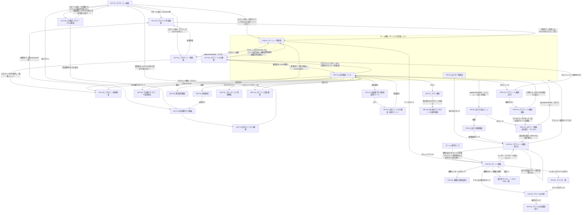

# 画面設計書

**複数アカウント切替メッセージアプリ（Orto）**
作成日：2026年8月21日

- 対象プロジェクト：Orto（個人モバイルアプリ開発）
- 本書の位置付け：機能仕様書（docs/specs/functional-spec.md）・データ設計書（docs/design/data/data-design.md）を元に、画面一覧・画面遷移・各画面の構成要素を定義する
- 関連ドキュメント：要件定義書、機能仕様書、データ設計書
- 本書はテキストベースで構成を定義する。詳細な見た目はFigma（非公開）にまとめている。

---

## 目次

1. [本書の目的・範囲](#1-本書の目的範囲)
2. [用語定義・画面ID命名規則](#2-用語定義画面id命名規則)
3. [画面一覧](#3-画面一覧)
4. [画面遷移図](#4-画面遷移図)
5. [各画面の詳細設計](#5-各画面の詳細設計)
  - [5.1 認証・起動](#51-認証起動)
    - [5.1.1 AUT-01 スプラッシュ画面](#511-aut-01-スプラッシュ画面)
    - [5.1.2 AUT-02 電話番号入力画面](#512-aut-02-電話番号入力画面)
    - [5.1.3 AUT-03 認証コード入力画面](#513-aut-03-認証コード入力画面)
    - [5.1.4 AUT-04 パスコード入力画面](#514-aut-04-パスコード入力画面)
    - [5.1.5 AUT-05 引き継ぎパスワード入力画面](#515-aut-05-引き継ぎパスワード入力画面)
    - [5.1.6 AUT-06 アップデート案内画面](#516-aut-06-アップデート案内画面)
  - [5.2 アカウント](#52-アカウント)
    - [5.2.1 ACC-01 アカウント一覧画面](#521-acc-01-アカウント一覧画面)
    - [5.2.2 ACC-02 アカウント作成画面](#522-acc-02-アカウント作成画面)
    - [5.2.3 ACC-03 アカウント削除画面](#523-acc-03-アカウント削除画面)
  - [5.3 チャット](#53-チャット)
    - [5.3.1 CHA-01 チャット一覧画面](#531-cha-01-チャット一覧画面)
    - [5.3.2 CHA-02 チャット画面（1対1）](#532-cha-02-チャット画面1対1)
    - [5.3.3 CHA-03 画像の全画面表示](#533-cha-03-画像の全画面表示)
    - [5.3.4 ALB-01 アルバム一覧](#534-alb-01-アルバム一覧)
    - [5.3.5 ALB-02 アルバムの中身](#535-alb-02-アルバムの中身)
    - [5.3.6 ALB-03 アルバムの全画面表示](#536-alb-03-アルバムの全画面表示)
  - [5.4 友だち](#54-友だち)
    - [5.4.1 FRI-01 友だち一覧画面](#541-fri-01-友だち一覧画面)
    - [5.4.2 FRI-02 友だち追加メニュー画面（モーダル）](#542-fri-02-友だち追加メニュー画面モーダル)
    - [5.4.3 FRI-03 友だち招待（共有シート）](#543-fri-03-友だち招待共有シート)
    - [5.4.4 FRI-04 友だち検索画面](#544-fri-04-友だち検索画面)
  - [5.5 QRコード](#55-qrコード)
    - [5.5.1 QRC-01 QRコード画面（フルスクリーン、読み取り⇔マイQRコードのトグル型）](#551-qrc-01-qrコード画面フルスクリーン読み取りマイqrコードのトグル型)
    - [5.5.2（欠番）旧QRC-02 QRコード表示画面](#552欠番旧qrc-02-qrコード表示画面)
  - [5.6 設定](#56-設定)
    - [5.6.1 SET-01 設定画面（ハブ）](#561-set-01-設定画面ハブ)
    - [5.6.2 SET-02 ブロックリスト管理画面](#562-set-02-ブロックリスト管理画面)
    - [5.6.3 SET-03 パスコード設定画面](#563-set-03-パスコード設定画面)
    - [5.6.4 SET-04 退会画面](#564-set-04-退会画面)
    - [5.6.5 SET-05 引き継ぎパスワード設定画面](#565-set-05-引き継ぎパスワード設定画面)
    - [5.6.6 SET-06 通知設定画面](#566-set-06-通知設定画面)
    - [5.6.7 SET-07 プラン画面](#567-set-07-プラン画面)
    - [5.6.8 SET-08 使い続けるアカウントの選択画面](#568-set-08-使い続けるアカウントの選択画面)
  - [5.7 プロフィール](#57-プロフィール)
    - [5.7.1 PRO-01 プロフィール画面_友だち](#571-pro-01-プロフィール画面_友だち)
    - [5.7.2 PRO-02 プロフィール画面_自分](#572-pro-02-プロフィール画面_自分)
    - [5.7.3 PRO-03 プロフィール編集画面](#573-pro-03-プロフィール編集画面)
  - [5.8 共通コンポーネント](#58-共通コンポーネント)
    - [5.8.1 AppHomeHeader（ホーム共通ヘッダー）](#581-apphomeheaderホーム共通ヘッダー)
    - [5.8.2 テキスト編集シート](#582-テキスト編集シート)
  - [5.9 通報](#59-通報)
    - [5.9.1 REP-01 通報画面](#591-rep-01-通報画面)
  - [5.10 グループ](#510-グループ)

---

## 1. 本書の目的・範囲

本書は、機能仕様書に定義された各機能の挙動を実現するために必要な画面（24画面。欠番のQRC-02を除く）について、画面一覧・画面遷移・構成要素・入力項目・異常系表示を定義する。

各画面の項目・構成・遷移・データの紐づけ・バリデーション・異常系は本書を正とする。一方で、色・フォント・座標・余白などピクセル単位のビジュアル情報は本書には転記せず、Figma（Orto）を常に正とする。実装時はFigma MCP等で直接Figmaフレームを参照し、本書はその上で「何をどう動かすか」を定義する位置付けとする。

---

## 2. 用語定義・画面ID命名規則

機能仕様書・データ設計書の用語定義に準じる。加えて本書では以下を定義する。

| 用語 | 定義 |
|---|---|
| ボトムナビゲーション | 画面下部に常設する3タブ（トーク／友だち／設定）。ログイン後のメイン画面群で共通表示する。 |
| ホーム画面 | ログイン後にボトムナビで相互に行き来する3画面（CHA-01・FRI-01・SET-01）の総称。独立した画面ID・実体は持たず、実装上はIndexedStackベースのシェル（5.8.1 AppHomeHeader参照）を指す。 |
| ハブ画面 | 複数の機能への入口となる画面。本書では「設定画面」を指す。 |

### 画面ID命名規則

画面IDは「カテゴリ3文字-2桁連番」形式で採番する（例：ACC-01）。旧版（1〜13の通し番号）は本改訂で全面的に本方式へ移行した。本命名規則は本プロジェクトに限らず、今後の他プロジェクトでも標準として使用する方針。

| カテゴリコード | 意味 | 元の英単語 |
|---|---|---|
| AUT | 認証・起動 | Authentication |
| ACC | アカウント管理 | Account |
| CHA | チャット | Chat |
| FRI | 友だち | Friend |
| QRC | QRコード | QR Code |
| SET | 設定 | Settings |
| PRO | プロフィール | Profile |
| REP | 通報 | Report |

カテゴリコードは英語の機能領域名の先頭3文字で統一し、Flutterのfeatureディレクトリ名とも対応させる。連番は2桁固定とし、新規画面はカテゴリ内の末尾に追加する（既存画面の番号を振り直さない）。

---

## 3. 画面一覧

旧1〜13の通し番号から新ID体系へ全面移行済み。FRI-02〜04・QRC-01/02・ACC-03を新規追加し、旧12プロフィール画面をPRO-01／PRO-02に分割した。

| ID | 画面名 | 対応する機能仕様書 | 実装状況 | ボトムナビ | MVP |
|---|---|---|---|---|---|
| AUT-01 | スプラッシュ画面 | 4.1.1 | 実装済み | － | ○ |
| AUT-02 | 電話番号入力画面 | 4.1.1 | 実装済み | － | ○ |
| AUT-03 | 認証コード入力画面 | 4.1.1 | 実装済み | － | ○ |
| AUT-04 | パスコード入力画面（起動時・アカウント切替時のガード） | 4.2.4（新設） | 実装済み（2026-09-21） | － | ○ |
| AUT-05 | 引き継ぎパスワード入力画面 | 4.1.4 | 実装済み（2026-10-01） | － | ○ |
| AUT-06 | アップデート案内画面 | 4.1.6 | 実装済み | － | ○ |
| ACC-01 | アカウント一覧画面 | 4.1.1, 4.2.1, 4.2.2（未読バッジ含む）, 4.2.3 | 実装済み | － | ○ |
| ACC-02 | アカウント作成画面 | 4.2.1 | 実装済み | － | ○ |
| ACC-03 | アカウント削除画面 | 4.2.3 | 実装済み | － | ○ |
| CHA-01 | チャット一覧画面 | 4.4.1, 4.4.2 | 実装済み | ○（1番目） | ○ |
| CHA-02 | チャット画面（1対1） | 4.4.2〜4.4.5 | 実装済み | － | ○ |
| CHA-03 | 画像の全画面表示 | 4.4.4 | 実装済み | － | ○ |
| ALB-01 | アルバム一覧 | 4.4.9 | 実装済み | － | ○ |
| ALB-02 | アルバムの中身 | 4.4.9 | 実装済み | － | ○ |
| ALB-03 | アルバムの全画面表示 | 4.4.9 | 実装済み | － | ○ |
| FRI-01 | 友だち一覧画面 | 4.3.2, 4.3.1（導線）, 4.3.8.2 | 実装済み | ○（2番目） | ○ |
| FRI-02 | 友だち追加メニュー画面（モーダル） | 4.3.1 | 実装済み | － | ○ |
| FRI-03 | 友だち招待（共有シート） | 4.3.5 | 実装済み（2026-09-24。招待リンクは2026-10-08） | － | ○ |
| FRI-04 | 友だち検索画面 | 4.3.1 | 実装済み（結果一覧表示のみ） | － | ○ |
| QRC-01 | QRコード画面（読み取り⇔マイQRコードのトグル型） | 4.3.1 | 実装済み（LINE準拠の統合改修、2026-09-02実装。2026-09-20にIDコピーの仕様を修正） | － | ○ |
| QRC-02 | （欠番）旧・QRコード表示画面 | 4.3.1 | 2026-09-02廃止、QRC-01に統合済み | － | － |
| SET-01 | 設定画面（ハブ） | 4.6、4.1.3〜4.1.5、4.2.3、4.2.4、4.3.4、4.5.1（各項目の入口） | 実装済み | ○（3番目） | ○ |
| SET-02 | ブロックリスト管理画面 | 4.3.4（新設・ブロック機能） | 実装済み（2026-09-20） | － | ○ |
| SET-03 | パスコード設定画面（2回入力） | 4.2.4（新設） | 実装済み（2026-09-21） | － | ○ |
| SET-04 | 退会画面 | 4.1.5 | 実装済み（2026-10-01） | － | ○ |
| SET-05 | 引き継ぎパスワード設定画面 | 4.1.4 | 実装済み（2026-10-01） | － | ○ |
| SET-06 | 通知設定画面 | 4.6.1 | 実装済み（2026-10-08） | － | － |
| SET-07 | プラン画面 | 4.6.4、4.2.1.3 | 実装済み | － | － |
| SET-08 | 使い続けるアカウントの選択画面 | 4.2.1.3 | 実装済み | － | － |
| PRO-01 | プロフィール画面_友だち | 4.5.2, 4.3.1, 4.3.3, 4.3.4 | 実装済み | － | ○ |
| PRO-02 | プロフィール画面_自分 | 4.5.1 | 実装済み | － | ○ |
| PRO-03 | プロフィール編集画面 | 4.5.1 | 実装済み | － | ○ |
| REP-01 | 通報画面 | 4.3.6 | 実装済み（2026-10-08） | － | ○ |

---

## 4. 画面遷移図

補足：

- 遷移の起点はAuthGate（AUT-01の判定）。ログイン状態・引き継ぎパスワードの確認状態・Accountの保有状況が変わると、表示する画面を自動で切り替える。AUT-03の認証成功・AUT-05の確認成功・ACC-02の作成完了・ACC-03の削除完了も、この切替で次の画面へ進む。
- 退会では、ホーム画面より上に開いている画面をすべて閉じる。サインアウトでAuthGateがAUT-02に切り替えるため、AUT-02へ戻る。
- ホーム画面を開いたときに、次のダイアログを出す（`HomeNoticesListener`）。
  - 利用規約とプライバシーポリシーの改定の再同意：今の版（`LegalLinks.documentVersion`）以降に同意していなければ出す。タイトル「利用規約とプライバシーポリシーを改定しました」、ボタンは「利用規約」「プライバシーポリシー」（ブラウザで開き、戻るともう一度出す）と「同意する」。同意を記録できるまで閉じない。記録に失敗したらSnackBar「記録できませんでした。…」
  - 引き継ぎパスワードの再設定の申請の警告：この電話番号のデータの削除が申請されていれば、申請ごとに1回出す。タイトル「データの削除の申請があります」、本文に削除の日時、ボタンは「閉じる」と「取り消す」（SnackBar「申請を取り消しました」）
- ボトムナビ（トーク／友だち／設定）のタブ切替はpush/popではなく、IndexedStackで各タブの状態を保ったまま表示を切り替える。アカウントを切り替えると、トークタブ（CHA-01）を表示する。
- AppHomeHeader（＋メニュー・QRアイコン・アバター）はCHA-01・FRI-01・SET-01に共通のため、遷移図ではホーム画面（HOME）全体からの矢印として示す（5.8.1）。
- AUT-04は画面遷移ではなく、パスコードを設定したアクティブなAccountが未解除の間、アプリ全体を覆って表示する（遷移図の点線）。起動時とアカウント切替時に表示し、SET-01でパスコードをOFFにするときの本人確認にも使う。新規設定はSET-03で行う（5.1.4・5.6.3）。
- ACC-01は、AUT-01の判定で表示したときは全画面でキャンセル不可。ホーム画面のアバターから開いたとき（アカウント切替）は画面中央に浮くカードで、外側タップで閉じて元のタブへ戻る（5.2.1）。
- ACC-03で削除した後はホーム画面へ戻る。削除したAccountがアクティブだった場合は、他に有効なAccountがあればそちらへ切り替え（アクティブなAccountが無い状態ならACC-01を表示）、1件も残っていなければACC-02へ進む。
- FRI-02はモーダルボトムシート。FRI-04・QRC-01は、シートの上に通常の画面としてpushする。
- FRI-04・QRC-01は結果を表示するだけで、友だち追加はPRO-01で確定する。QR読み取り成功時はQRC-01をPRO-01で置き換えるため、PRO-01を閉じるとQRC-01を開く前の画面に戻る。
- PRO-01のチャットアイコンでCHA-02を開くときは、ホーム画面より上の画面を取り除いてから開く（CHA-02から戻るとホーム画面）。CHA-02のヘッダーから開いたPRO-01では、チャットアイコンを表示しない。相手のAccountが未取得・削除済みのときは、CHA-02のヘッダーをタップしても遷移しない（5.3.2・5.7.1）。
- 友だちでない相手とのCHA-02は閲覧のみで、入力欄の代わりに「友だち追加」「ブロック」「通報」ボタンを表示する（5.3.2）。
- REP-01（通報）は、PRO-01の「通報」・CHA-02の相手のメッセージの長押しメニューの「通報」・リクエストモードの「通報」から通常の画面として開く。通報すると元の画面に戻る。同時にブロックした場合は、ブロックと同じくホーム画面（PRO-01から）またはCHA-01（CHA-02から）へ戻る（5.9.1）。
- プッシュ通知をタップすると、通知先のアカウントに切り替え、ホーム画面より上の画面を閉じてからCHA-02を開く（機能仕様書4.4.6.1）。通知先のアカウントにパスコードがあれば、解除済みでも必ずAUT-04を通す（解除前に開くと、本人が見ていないメッセージが既読になるため）。通知先が自分のアカウントでない場合や、通知にトークのデータが無い場合は、通常どおり起動する。アプリ表示中に受けた通知は、画面上部のバナー「新規メッセージがあります」（閉じるボタン付き、4秒で消える）で知らせる。ただし、いま開いて見ているCHA-02宛ての新着では出さない。

---

## 5. 各画面の詳細設計

---

### 5.1 認証・起動

#### 5.1.1 AUT-01 スプラッシュ画面

| 項目 | 内容 |
|---|---|
| 役割 | アプリ起動時にFirebase Authenticationのセッション有無を判定し、ログイン状態に応じて次画面へ自動遷移する。ユーザー操作を伴わない。起動時のほか、引き継ぎパスワードの確認状態・Account一覧の読み込み中にも本画面を表示する。 |
| 関連機能 | 4.1.1 ログイン／サインアップ |

<kbd>構成要素</kbd>

- アプリロゴ／アイコン
- アプリ名「Orto」
- ローディングインジケーター（ロゴ直下の不定進捗プログレスバー。2026-09-22。幅は最大200dp、色はAppColors.accent。従来の丸スピナーは廃止）
- 「読み込み中…」（処理が1.5秒以上続いた場合のみ、バーの下に追加表示する）

<kbd>遷移</kbd>

上から順に判定する。

- 未ログイン　→　AUT-02（電話番号入力画面）
- ログイン済み・引き継ぎパスワードの確認が済んでいない（新しい端末でのログイン）　→　AUT-05（引き継ぎパスワード入力画面）
- ログイン済み・Account 0件　→　ACC-02（アカウント作成画面）
- ログイン済み・前回アクティブなAccountあり　→　CHA-01（チャット一覧画面）。そのAccountにパスコードを設定している場合は、CHA-01の上をAUT-04で覆う（5.1.4参照）
- ログイン済み・アクティブなAccountなし　→　ACC-01（アカウント一覧画面）

<kbd>異常系</kbd>

- セッション確認処理のエラー　→　電話番号入力画面へフォールバックする
- 引き継ぎパスワードの確認状態を読めない（オフライン等）　→　確認済みとして次の判定へ進む
- Account一覧の取得失敗　→　本画面に「アカウント情報を読み込めませんでした。通信環境を確かめて、もう一度お試しください。」と「再試行」ボタンを表示する。例外の文は画面に出さず、ログにだけ残す
- Firebaseの初期化失敗（10秒でタイムアウト）　→　白画面のまま止まらないよう、専用の画面に「アプリを起動できませんでした」「通信環境を確かめて、アプリを起動し直してください。」を出す。例外とスタックトレースは画面に出さず、ログにだけ残す（デバッグビルドだけ画面にも出す）

---

#### 5.1.2 AUT-02 電話番号入力画面

| 項目 | 内容 |
|---|---|
| 役割 | 電話番号を入力し、SMS認証コードを送る。 |
| 関連機能 | 4.1.1 ログイン／サインアップ、4.1.3 電話番号の変更（変更モード） |
| 入口 | AUT-01（未ログイン）、SET-01の「電話番号」（変更モード、5.1.2.1） |

<kbd>構成要素</kbd>

- タイトル「電話番号を入力してください」
- 国番号ボタン（選んだ国・地域の国旗と国番号。初期値は日本の+81。タップで国・地域の一覧をボトムシートで開く。一覧は国名・国番号を表示し、国名で検索できる。日本を先頭に表示する）
- 電話番号入力欄（数字・ハイフン・スペース・`+`を入力可。ヒントは、日本なら`090XXXXXXXX`、その他の国はその国の番号の例。端末の電話番号をキーボードの上の候補から入れられる（変更モードでは出さない））
- 次へボタン（バリデーション通過まで非活性）
- 同意の案内（サインインのときだけ。「次へ」を押すと利用規約とプライバシーポリシーに同意したものとする旨の文と、両方の文書を外部ブラウザで開くリンク）
- 招待の貼り付けの案内（iOS 16以降のサインインで、初回起動時にクリップボードにURLがありそうなときだけ。タイトルの下に出す。機能仕様書4.3.5.2）：見出し「招待リンクから来ましたか？」、説明（「招待のページでコピーした招待を下のボタンで貼り付けると、ログインの後に、そのまま友だち追加やグループへの参加に進めます。」）、システムの貼り付けボタン（「ペースト」）、閉じるボタン。貼り付けた内容が招待リンクなら、見出しの左に印（✓）を付けて「招待を受け取りました」と招待したアカウントのID（グループならグループへの参加に進む旨）に変わり、貼り付けボタンは消える。そうでなければボタンの下に赤字で「招待リンクではありませんでした」を出す。招待リンクでアプリが開いた後は出さない
  - 見た目：カードは白（ダークは`surface`）の角丸16で、余白は上下左右とも16。閉じるボタン（×、32pt四方）は右上の角に寄せ、見出しの行と高さをそろえる。説明は見出しの8下、貼り付けボタンは説明の16下に置く。貼り付けボタンは「次へ」と同じ高さ48・カードの幅いっぱいのカプセル形で、背景はアクセントの色、文字はライトでは白、ダークでは画面の背景の暗い色（淡いアクセントの上で白は読みにくいため。コントラスト比4.5以上）
- 戻るボタンは無い

<kbd>入力項目・バリデーション</kbd>

- 電話番号（必須）。選んだ国・地域の番号として正しいこと（国内形式は先頭の0の有無を問わない。`+`始まりなら入力された国番号を優先する）。送信時にE.164形式へ正規化する（機能仕様書4.1.1）

<kbd>遷移</kbd>

- 次へ（SMS送信成功）　→　AUT-03（認証コード入力画面）

<kbd>異常系</kbd>

いずれも入力欄の下にインラインで表示し、入力を変更すると消える。

- 不正な電話番号形式　→　「電話番号の形式が正しくありません」
- ネットワークエラー　→　「通信エラーが発生しました。再度お試しください」
- 過剰なSMS送信要求　→　「リクエストが多すぎます。しばらく時間をおいて再度お試しください」
- SMSを送れない国・地域の番号　→　「この国・地域の電話番号には対応していません」

> ##### 5.1.2.1 変更モード（電話番号の変更）
>
> SET-01の「電話番号」から開いた場合は、本画面を変更モードで表示する（機能仕様書4.1.3）。
>
> <kbd>構成要素</kbd>
>
> - 左上に戻るボタンを表示する
> - タイトル「電話番号の変更」
> - タイトルの下に説明「新しい電話番号を入力してください。SMSで届く認証コードで確認します。アカウント・トーク・友だちはそのまま引き継がれます。」
>
> <kbd>遷移</kbd>
>
> - 次へ　→　AUT-03（変更モード）。端末側で自動的に認証が完了した場合（Android）はAUT-03を経由しない
> - 変更完了　→　SET-01
>
> <kbd>異常系</kbd>
>
> 通常モードの異常系に、次が加わる。
>
> - 別のユーザーが使っている番号　→　「この電話番号は、すでに別のユーザーで使われています」
> - 現在と同じ番号　→　「現在と同じ電話番号です」

---

#### 5.1.3 AUT-03 認証コード入力画面

| 項目 | 内容 |
|---|---|
| 役割 | SMSで届いた認証コードを入力してサインインする。 |
| 関連機能 | 4.1.1 ログイン／サインアップ |
| 入口 | AUT-02。ほかにAUT-02の変更モード・AUT-04の「パスコードを忘れた場合」（5.1.3.1） |

<kbd>構成要素</kbd>

- 戻るボタン
- タイトル「認証コードを入力してください」
- 送信先電話番号の表示（「{電話番号} に送信しました」）
- 6桁コード入力欄（数字のみ。SMSで届いたコードをキーボードの上の候補から入れられる。6桁そろうと「確認」を押さなくても確認する）
- 再送リンク（送信後60秒間は「コードを再送する（{秒}秒後に可能）」と表示して無効。再送するとSnackBar「認証コードを再送しました」）
- 確認ボタン（6桁入力まで非活性）

<kbd>入力項目・バリデーション</kbd>

- SMS認証コード（必須）。6桁数字、有効期限内

<kbd>遷移</kbd>

- 認証成功　→　AuthGateがAUT-01と同じ判定で次の画面を表示する（引き継ぎパスワード未確認→AUT-05、Account未作成→ACC-02、Account既存→ACC-01。サインアウト時に前回アクティブなAccountの記録は消すため、通常はACC-01になる）

<kbd>異常系</kbd>

いずれも入力欄の下にインラインで表示する。

- コード不一致　→　「認証コードが一致しません」。3回以上失敗すると「認証コードが繰り返し一致しません。コードを再送してください」を追加表示
- コード有効期限切れ　→　「コードの有効期限が切れました」（再送リンクから再送）
- ネットワークエラー　→　「通信エラーが発生しました。再度お試しください」
- その他のサインイン失敗　→　「サインインに失敗しました」

> ##### 5.1.3.1 他の画面からの利用
>
> AUT-02の変更モード（電話番号の変更）と、AUT-04の「パスコードを忘れた場合」（SMS再認証）からも本画面を使う。いずれも認証に成功したら本画面だけを閉じて呼び出し元へ戻る。

---

#### 5.1.4 AUT-04 パスコード入力画面

| 項目 | 内容 |
|---|---|
| 役割 | 対象アカウントの4桁パスコードを検証するゲート画面。下記の3つの場面で共通コンポーネントとして使用する（UI・テンキーは共通、遷移先のみ分岐）。実装では`PasscodeEntryScreen`（ui/passcode）がガード・確認の2モードを持つ。 |
| 関連機能 | 4.2.4 パスコードロック |
| 実装状況 | 実装済み（2026-09-21）。見た目は既存トークン（AppColors・AppAvatar等）による暫定。 |

<kbd>使われる場面</kbd>

1. 起動時ガード：前回アクティブアカウントにパスコードが設定されていれば、ホーム画面（CHA-01）の上を本画面で覆う。認証成功で覆いを外し、下のホーム画面を表示する。
2. アカウント切替ガード：ACC-01でアカウント選択後、選択したアカウントにパスコードが設定されていれば、同じく画面全体を本画面で覆う。認証成功で選択したアカウントのホーム画面を表示する。プッシュ通知のタップで通知先のアカウントに切り替える場合も同じで、通知先がすでに解除済みのアカウントでも、必ず本画面を表示する。認証成功で通知のトーク（CHA-02）を開く（4章補足参照）。
3. SET-01のパスコードトグルOFF確認：現在アクティブなアカウントの本人確認として、通常の画面遷移で開く。正しい入力でOFFが確定しSET-01へ戻る。

<kbd>構成要素</kbd>

- 対象アカウントのアバター・アカウント名（どのアカウントに入ろうとしているかを明示）
- 見出し（ガード時「パスコードを入力」、OFF確認時「現在のパスコードを入力」）
- 自前テンキー（LINEのようなドット表示（4桁分）＋数字ボタン　0〜9・削除。システム標準キーボードは使用しない。2026-09-21確定）。アカウント表示・見出し・ドットとテンキーを24pt間隔の1つのまとまりにし、「パスコードを忘れた場合」の欄（56pt）より上の領域の、中央より少し下に置く（テンキーだけを下端に固定すると、背の高い端末ほどテンキーが下に寄るため。2026-10-08。アバターが上に寄って見えないよう、領域の空きを上8：下2で分ける。低い端末でははみ出さずにスクロールできる）
- 「パスコードを忘れた場合」リンク（起動時・切替時ガードのみ表示。SET-01のOFF確認モードでは非表示。OFF確認はパスコードを知っていることを前提とする操作のため、忘れた場合の救済導線は不要）
- 閉じるボタン（×、右上。起動時・切替時ガードのみ。パスコードが分からなくても、別のアカウントに切り替えて操作を続けられるようにする）
- 戻るボタン（OFF確認モードのみ）

<kbd>入力項目・バリデーション</kbd>

- 4桁数字。入力が4桁に達した時点で自動確定（送信ボタン等は不要）

<kbd>遷移</kbd>

- 起動時・切替時ガードでの認証成功　→　対象アカウントで通常の遷移先へ
- 「パスコードを忘れた場合」タップ（起動時・切替時のみ）　→　ログイン中の電話番号にSMSを送り、AUT-03（再認証）で認証する（Androidで自動的に認証が完了した場合はAUT-03を経由しない）。成功すると該当アカウントのデバイスローカルパスコードを削除し（未設定状態に戻る）、ガードを外して下の画面を表示する
- 閉じるボタン（起動時・切替時のみ）　→　解除せずにアクティブなAccountを未選択に戻し、ACC-01（全画面）を表示する。ガードの下に積まれていた画面は閉じる。パスコードは残るため、同じAccountを選ぶと再度本画面を表示する
- SET-01のOFF確認での認証成功　→　SET-01へ戻りトグルがOFFになる

<kbd>異常系</kbd>

- 誤入力　→　即座に入力をクリアし、4つのドットの代わりに赤字で「パスコードが違います。もう一度入力してください」を表示する（次の入力で消えてドットに戻る。表示の高さは変えず、テンキーは動かない。SET-03の不一致も同じ）。リトライ回数制限・ロックアウトは設けない（方針確定済み）
- 5回以上続けて誤り　→　ドットの代わりに赤字で「続けて間違えたため、あと{秒数}秒お待ちください」（1分以上は「あと{分数}分」）を出し、待つ間は入力を受け付けない（機能仕様書4.2.4.5）
- 10回続けて誤り　→　「続けて間違えたため、入力できません。「パスコードを忘れた場合」から解除してください」。確認モードでは、起動時の画面から解除するよう案内する
- SMSの送信失敗　→　SnackBarでAUT-02と同じエラー文言を表示
- SMS再認証失敗（コード不一致等）　→　AUT-03と同じエラー表示
- 再認証には成功したがパスコードを削除できなかった　→　SnackBar「パスコードを解除できませんでした。もう一度お試しください」

> ##### 5.1.4.1 ガードの仕組み（起動時・切替時）
>
> - 画面遷移ではなく、アプリの画面全体（Navigator）の上に重ねて表示する（`PasscodeGuard`）。下の画面は破棄せず保つ。
> - 解除済みとして覚えるのは直近に解除した1アカウントのみで、別のアカウントに切り替えてから戻ると再度入力を求める。
> - アプリをバックグラウンドから戻しただけでは再ロックしない（プッシュ通知のタップで開いた場合を除く）。
> - パスコードの有無を確認できるまでは、画面の内容を背景色で隠す。
> - ガード中にAndroidの戻るボタンを押すと、ガードを迂回せずアプリを閉じる。

---

#### 5.1.5 AUT-05 引き継ぎパスワード入力画面

| 項目 | 内容 |
|---|---|
| 役割 | 引き継ぎパスワードを登録済みのユーザが、新しい端末でSMS認証した直後に、パスワードを確認する。 |
| 関連機能 | 4.1.4 引き継ぎパスワード |
| 入口 | AuthGateが、ログイン済みでパスワードの確認が済んでいないセッションのときに表示する。 |
| 実装状況 | 実装済み（2026-10-01） |

<kbd>構成要素</kbd>

- タイトル「引き継ぎパスワードの確認」
- 説明（「この電話番号には引き継ぎパスワードが設定されています。新しい端末で使うには、パスワードを入力してください。」）
- パスワード入力欄（伏字）
- 「確認」ボタン（未入力時は非活性）
- 「パスワードを忘れた場合」リンク（再設定の申請中は、代わりに「{日時}以降に、以前のデータを削除します。…」の案内と「申請を取り消す」リンク）
- 「お問い合わせ」リンク（端末のメールアプリを開く）
- 「電話番号の入力に戻る」リンク
- 戻るボタンは無い

<kbd>遷移</kbd>

- 確認成功　→　通常のアカウントの画面（ACC-01／ACC-02／ホーム）へ自動的に切り替わる
- 「パスワードを忘れた場合」　→　案内のダイアログ（タイトル「パスワードを忘れた場合」。再発行できないこと、以前の端末から設定し直せること、使えない場合は以前のデータを削除して始め直せること（申請から7日後、その間は以前の端末から取り消せる）を案内する。実行ボタン「データを削除して始め直す」）→　確認のダイアログ（「以前のデータを削除しますか？」、実行ボタン「申請する」）→　申請（機能仕様書4.1.4.3）。失敗したらSnackBar「申請できませんでした。…」
- 「申請を取り消す」　→　申請を取り消し、SnackBar「申請を取り消しました」
- 「電話番号の入力に戻る」　→　サインインを取り消して（サインアウトし、前回アクティブなAccountの記録も消して）AUT-02

<kbd>異常系</kbd>

いずれも入力欄の下に赤字で表示する。

- パスワード誤り　→　「パスワードが違います」
- 続けて間違えた　→　「続けて間違えたため、しばらくしてからお試しください」
- 通信エラー　→　「通信に失敗しました。通信環境を確認して、もう一度お試しください」

---

#### 5.1.6 AUT-06 アップデート案内画面

| 項目 | 内容 |
|---|---|
| 役割 | 動かせる最低のバージョンより古いアプリの利用を止め、ストアでの更新へ案内する。どの画面の上にも全画面で表示し、閉じる手段は無い。 |
| 関連機能 | 4.1.6 強制アップデート |

<kbd>構成要素</kbd>

- アプリのアイコン
- 見出し「アップデートが必要です」
- 本文「新しいバージョンのアプリをインストールしてください」
- 「アップデート」ボタン（そのOSのストアのURLが設定されているときのみ）

<kbd>遷移</kbd>

- 「アップデート」　→　外部のストアアプリを開く

---

### 5.2 アカウント

#### 5.2.1 ACC-01 アカウント一覧画面

| 項目 | 内容 |
|---|---|
| 役割 | 保有するAccountの一覧を表示し、アカウントの切替・新規作成・削除の入口とする。 |
| 関連機能 | 4.1.1, 4.2.1, 4.2.2（未読バッジ含む）, 4.2.3（削除導線） |
| 表示方式 | AUT-03（認証コード入力画面）からの初回遷移時はAccount未選択状態のホーム画面として全画面表示し、キャンセル導線は設けない。ホーム画面（AppHomeHeaderのアバター）からの「アカウント切替」目的での遷移時は画面中央に浮くカードとして表示し、カードの外側のタップでキャンセル可能とする。背景は暗くする。カードの高さはAccountの数に合わせ、画面に収まらない分はカードの中でスクロールする。 |

<kbd>構成要素</kbd>

- タイトル「アカウント」
- 新規作成ボタン（＋。上限到達時もボタンは表示し、タップで上限の案内つきのSET-07へ進む。上限は`users/{uid}.plan`で決まる：free 2件・grade1 3件・grade2 5件・admin無制限。プランの取得前は無料プランの上限で判定する。2026-09-24変更）
- Accountリスト（作成日時順。アイコン・表示名・未読合計バッジ（表示名の右）・ひとこと（設定時のみ、2行まで）。使用中のAccountの行は背景色で強調する。パスコードロックを設定したAccountは行の右端に鍵マークを表示する）
- 「プロフィール」ボタン（アカウント切替目的の中央のカードで、使用中のAccountの行にのみ表示する。全画面表示では出さない）
- Accountが0件の場合は「アカウントがありません」と表示する（通常はACC-02が表示されるため到達しない）
- パスコードを設定したAccountは、解除していない間、「!」・ひとことを出さず、アイコン・表示名・未読合計バッジだけを表示する。ホームのヘッダーの「ほかのアカウントの未読」には含め、「!」には含めない。未読は件数だけで、メッセージの内容は出さない

<kbd>未読バッジ</kbd>

- 各Accountについて、そのAccountが参加する全チャットルームの未読メッセージ数合計を表示する。0件の場合は非表示。グループへの招待が届いているAccountは、未読に関わらず「!」を表示する（招待の状態は開いている間も反映する。データ設計書3.2.4）。
- 集計方式はデータ設計書3.2.4参照（画面表示のたびに都度集計、常時リスナーは張らない）。
- 表示形式：上限なしの実数表示（3桁以上も「99+」に丸めない）。

<kbd>遷移</kbd>

- Accountをタップ　→　CHA-01（チャット一覧画面。該当Accountをアクティブ化）。中央のカードで開いた場合はカードを閉じ、全画面表示の場合はホーム画面に置き換える。選んだAccountにパスコードを設定している場合は、その上をAUT-04で覆う（5.1.4参照）
- 「プロフィール」ボタンをタップ　→　カードを閉じてPRO-02（プロフィール画面_自分）へ
- ＋タップ（上限内）　→　ACC-02（アカウント作成画面）
- ＋タップ（上限到達）　→　SET-07（プラン画面。上部に上限の案内を表示）
- アカウント行を長押し　→　アカウント削除メニュー（ボトムシート。項目は赤字の「アカウント削除」のみ）を表示。「アカウント削除」を選択でACC-03（アカウント削除画面）へ
- カードの外側をタップ（アカウント切替目的で開いた場合のみ）　→　キャンセルして遷移元のタブ（CHA-01／FRI-01／SET-01）へ戻る（Account切替は行わない）

<kbd>異常系</kbd>

- Account取得失敗　→　「アカウント一覧の取得に失敗しました」＋再読み込みボタン
- 未読バッジ集計失敗　→　バッジを表示しない
- Accountの切替は端末内の保存のみで通信を伴わないため、切替失敗の表示は無い

---

#### 5.2.2 ACC-02 アカウント作成画面

| 項目 | 内容 |
|---|---|
| 役割 | 新しいAccountを作成する。 |
| 関連機能 | 4.2.1 アカウント作成 |
| 入口 | ACC-01の＋（上限内）、AUT-01の判定（Account 0件）、ACC-03での削除完了後に残りAccountが0件になった場合（強制的にアカウント作成を促す。4章参照で確定） |

<kbd>構成要素</kbd>

- タイトル「{n}つ目のアカウントを作成」（nは作るアカウントが何件目になるか。保有するAccount数＋1で、画面を開いたときの値に固定する。一覧を読み込めていない間は「アカウント作成」）
- 戻るボタン（初回・全Account削除後の強制表示時は無し）
- プロフィール画像選択（任意。アバター（右下にカメラのバッジ）または「画像を選択」ボタンのタップで「カメラで撮影」／「ギャラリーから選択」を選ぶ）
- 表示名入力欄（上に見出し「表示名」、欄の中に薄いヒント「表示名を入力」。入力欄はiOS風に、見出しを欄の外に固定で出し、欄の中には薄いグレーのヒントだけを出す。FRI-04・SET-05も同様）
- アカウントID入力欄（上に見出し「アカウントID」、欄の中に薄いヒント「アカウントIDを入力」）と「使用可能か確認」ボタン
- 入力欄の下にIDの状態表示（未入力時「半角英数字・記号（. - _）のみ、4〜20文字」、形式が正しく未確認の間「「使用可能か確認」で確認できます（未確認でも作成は可能です）」、確認中「確認中...」、使用可能「✓ 使用可能です」）
- 「※アカウントIDは作成後に変更・削除できません」の注記
- 招待してくれた人のアカウントIDの入力欄（任意。保有するAccountが0件からの作成で、招待リンク・貼り付けで受け取った招待が無いときだけ。見出し「招待してくれた人のアカウントID（任意）」、下に「入れると、作成の後にその人を友だち追加できます」。作成の直後に、ACC-01を挟まずにその人のPRO-01へ進む。機能仕様書4.3.5.2）
- 「作成する」ボタン

<kbd>入力項目・バリデーション</kbd>

- 表示名（必須、前後の空白を除いて1〜20文字）
- アカウントID（必須、半角英数字及び記号のドット・ハイフン・アンダースコアのみ、4〜20文字。予約IDは「このIDは使用できません」と表示し作成不可）。「使用可能か確認」は形式が正しいときのみ押せる任意の確認で、未確認でも作成できる（最終的な重複はサーバー側で判定）
- プロフィール画像（任意。選択時に長辺1080px・JPEG品質85に縮小・圧縮し、5MB未満）
- 招待してくれた人のアカウントID（任意。入れるならアカウントIDと同じ形式。形式が違えば入力欄の下に「半角英数字・記号（. - _）のみ、4〜20文字で入力してください」を出し、作成できない）。作成できたら、招待リンクを開いたときと同じく、ホームでその人のPRO-01へ進む

<kbd>遷移</kbd>

- 作成する（成功）　→　作成したAccountをアクティブ化して遷移元へ戻る（ACC-01から開いた場合はACC-01に戻る。初回・全Account削除後はCHA-01へ）。保有するAccountが0件からの作成で、引き継ぎパスワードが未設定なら、ホームの上にダイアログ「引き継ぎパスワードを設定しませんか」を1回だけ出す（「設定する」でSET-05、「あとで設定する」で閉じる。機能仕様書4.1.4.1）。招待から来た人は、作成の直後に招待の先へ直行するため、ダイアログは次の起動で出す

<kbd>異常系</kbd>

- 表示名未入力／アカウントID未入力　→　作成ボタン非活性
- 表示名の文字数違反　→　「表示名は1〜20文字で入力してください」
- アカウントID形式違反　→　「半角英数字・記号（. - _）のみ、4〜20文字で入力してください」
- アカウントID使用済み（事前チェック）　→　「このIDは既に使用されています」
- アカウントID二重使用（作成時）　→　「このIDは他の方に使用されました。別のIDを入力してください」
- 画像アップロード失敗　→　アカウントは画像なしで作成を完了し、SnackBar「画像のアップロードに失敗しました。アカウントは画像なしで作成されました」を表示する
- 画像の選択（カメラ撮影・アルバム）に失敗　→　SnackBarで案内する（権限拒否の場合は「カメラの利用が許可されていません。…」／「写真へのアクセスが許可されていません。…」、それ以外は「画像を選択できませんでした。もう一度お試しください」。2026-09-22追加、5.5.1と共通）
- ネットワークエラー・アカウント数上限超過（サーバー側で拒否）　→　「作成に失敗しました。再度お試しください」、入力内容を保持し再試行可能（作成時のエラーは注記の下に赤字で表示する）。上限到達時はACC-01の＋ボタンから本画面へ進まないため、通常は本画面に到達しない

---

#### 5.2.3 ACC-03 アカウント削除画面

| 項目 | 内容 |
|---|---|
| 役割 | 削除対象のAccountについて確認の画面を表示し、isDeleted: trueへのソフトデリートを実行する（データ設計書3.2参照）。 |
| 関連機能 | 4.2.3 アカウント削除 |
| 入口 | ACC-01のアカウント行の長押しメニュー、またはSET-01の「アカウント削除」（アクティブなAccountが対象） |
| 入力項目 | なし（ボタン操作のみ）。未読メッセージ件数等による削除制約は設けない。 |

<kbd>構成要素</kbd>

- タイトル「アカウント削除」
- 戻るボタン
- 削除対象Accountのアイコン・表示名
- 説明文（「このアカウントを削除しますか？／削除すると、相手には「退会済みアカウント」として表示されます。／トーク履歴は削除されません。／（空行）／※削除後は、このIDを使って新しいアカウントを作成できません。」）
- 「削除する」ボタン（赤背景）。削除時は、そのAccountの端末内のパスコード設定も消す
- 「キャンセル」ボタン

<kbd>遷移</kbd>

- 削除する（ロック中のAccount）　→　先にAUT-04（確認モード）を開き、正しいパスコードを入力できたら削除する
- 削除する（成功、他に有効なAccountが残っている場合）　→　ホーム画面まで戻る（開いていたタブのまま）。削除したAccountがアクティブだった場合は、残りのAccountの先頭へ自動切替し、切替先のCHA-01を表示する（アクティブなAccountが無い状態ならACC-01を表示）
- 削除する（成功、残りAccountが0件になる場合）　→　ACC-02（アカウント作成画面。強制的にアカウント作成を促す）
- キャンセル　→　遷移元の画面へ戻る

<kbd>異常系</kbd>

- ネットワークエラー　→　説明文の下に赤字で「削除に失敗しました。再度お試しください」

---

### 5.3 チャット

#### 5.3.1 CHA-01 チャット一覧画面

| 項目 | 内容 |
|---|---|
| 役割 | アクティブなAccountのトークルームの一覧を表示する。ホーム画面の1つ目のタブ。 |
| 関連機能 | 4.4.1 トーク一覧（未読バッジ含む）、4.4.2 トークリクエスト、4.2.2 アカウント切替（切替導線） |
| 入力項目 | なし |

<kbd>構成要素</kbd>

- AppHomeHeader（5.8.1参照。タイトル"Chats"/"トーク"、＋／QR／アバターの3アイコン）
- チャットルームリスト（最終メッセージ日時の新しい順。相手アイコン・表示名・最新メッセージ（1行。画像メッセージは「画像」と表示）・時刻・未読バッジ。時刻は、今日なら時刻（CHA-02の吹き出しの時刻と同じ形式）、昨日なら「昨日」、7日以内なら曜日、それより前は月日（日本語は「09/18」形式、英語は「Sep 18」形式）。未読があるルームの行は背景色で強調する。ニックネーム設定時はニックネームを優先表示。相手Accountが削除済みの場合は「退会済みアカウント」（画像なし）、取得できない場合は「不明なアカウント」と表示）
- 未確認のトークリクエストセクション（5.3.1.1）
- ボトムナビゲーション（チャットタブのアイコンに未読合計バッジを表示。表示形式：上限なしの実数表示（3桁以上も「99+」に丸めず表示）、形状は角丸（ピル形）。グループへの招待が届いている間は、未読に関わらず「!」を表示する）
- フィルタタブ（全て／個人／グループ）はMVPでは非表示とする（2026-09-02（3）方針変更。従来の「グループのみプレースホルダー表示」からタブ列ごと非表示へ再変更）。グループチャット機能自体がスコープ外（要件定義書4.3）であり、グループが存在しない状態では「全て」と「個人」を分ける意味も無いため、フィルタタブ行そのものを置かない（実装コードも削除した。v1.1以降でグループ機能を実装する際に作り直す）

<kbd>遷移</kbd>

- AppHomeHeaderの各アイコン　→　5.8.1参照（アバター→ACC-01）
- ルームタップ　→　CHA-02（チャット画面）
- ボトムナビ「友だち」　→　FRI-01（友だち一覧画面）
- ボトムナビ「設定」　→　SET-01（設定画面）

<kbd>正常系の挙動</kbd>

- 新着メッセージ受信時、Firestoreのリアルタイムリスナーで一覧が自動更新され、該当ルームが先頭に移動する。
- 未読合計バッジは、一覧取得時に取得済みのunreadCountをクライアント側で合計するだけで、追加のFirestore読み取りは発生しない。集計の対象は一覧に表示するルーム（通常＋トークリクエスト）のみで、ブロックした相手など一覧に出ないルームの未読は含めない。

<kbd>空状態</kbd>

- 「まだトークがありません。友だちを追加するとここに表示されます。」

<kbd>異常系</kbd>

- 一覧取得失敗　→　「トーク一覧の取得に失敗しました」＋再読み込みボタン
- オフライン時は専用の表示を持たず、Firestoreのキャッシュ内容をそのまま表示する

> ##### 5.3.1.1 未確認のトークリクエストセクション（LINE準拠）
>
> - 友だちリストに存在しない相手からのメッセージを含むルームが1件以上ある場合のみ、チャットルームリストの先頭に専用セクションを表示する（0件時は非表示。自分がブロックした相手・自分をブロックした相手のルームは対象外）。
> - セクションの行には封筒のアイコン・「未確認のトークリクエスト（{件数}）」・リクエスト分の未読合計バッジ・展開／折りたたみの矢印を表示し、初期状態は折りたたみ。
> - タップでリクエストルーム一覧をセクションの直下に展開し（行の見た目は通常のルームと同じ）、選択するとCHA-02をリクエストモード（返信不可、「友だち追加」/「ブロック」/「通報」ボタン常設）で開く。
> - 友だちでなく、メッセージも無い相手のルームは一覧に表示しない。
> - 詳細は4章・5.3.2.1参照。

---

#### 5.3.2 CHA-02 チャット画面（1対1）

| 項目 | 内容 |
|---|---|
| 役割 | 1対1のトークでメッセージ（テキスト・画像）を送受信する。 |
| 関連機能 | 4.4.2 トークリクエスト、4.4.3 テキストメッセージ、4.4.4 画像メッセージ、4.4.5 メッセージの操作 |
| 入口 | CHA-01のルーム、PRO-01のチャットアイコン、プッシュ通知のタップ（4章補足参照） |

> 使用中のアカウントが読み取り専用（機能仕様書4.2.1.3）の間は、入力欄の代わりに案内文と「プランを見る」（SET-07へ）を表示する。

<kbd>構成要素</kbd>

- ヘッダー（戻るボタン、相手アイコン、相手表示名。ニックネーム設定時はニックネームを優先表示。相手Accountが削除済みの場合は「退会済みアカウント」（画像なし）、取得できない場合は「不明なアカウント」と表示）
- メッセージリスト（自分／相手の吹き出しを左右で区別、時系列順。日付が変わる位置に日付の区切り（日本語は「2026年9月18日(金)」形式、英語は「Sep 18, 2026」形式）を表示。直近50件を表示し、上にスクロールすると50件ずつ過去分を読み込む。0件時、または相手とまだ1通もやり取りしていない（ルームが無い）場合は「まだメッセージがありません」）
- リアクション（付いている場合、吹き出しの下に絵文字ごとに集計して表示。2件以上なら「👍 2」のように件数を付ける。相手のメッセージでは、タップするとタップ位置の近くにリアクション行（5.3.2.3と同じ6種）だけを出し、選んだ絵文字に変える。付けている絵文字を選ぶと解除、外側のタップで閉じる）
- 吹き出しの下の行に時刻（日本語は24時間表記の「15:05」形式、英語は「3:05 PM」形式）と、自分の送信メッセージの状態（送信中は時計アイコン、送信失敗は再送アイコン、相手が既読にしたら「既読」。いずれも時刻の左）
- 画像ボタン（テキスト入力欄の左。5.3.2.4）
- テキスト入力欄（ヒント「メッセージを入力」、最大4行まで伸びる）
- 送信ボタン（入力欄の右に常に表示する。本文が空のときは押せない。送信中はスピナー）
- 入力バーの背景は、バーと同じ色のまま画面の下端（ホームインジケータの領域、キーボードの裏）まで続け、境目を見せない。入力バーの下の余白はキーボードの動きに合わせて毎フレーム変え、アニメーションを重ねない

<kbd>入力項目・バリデーション</kbd>

- メッセージ本文（必須、1〜2000文字、空白のみ不可。前後の空白は除いて送信）
- 画像（1枚。選択時に長辺1920px以下・JPEG品質85に圧縮し、10MB未満であること）

<kbd>遷移</kbd>

- ヘッダー（相手アイコン＋表示名）タップ　→　PRO-01（5.3.2.2）
- ピン留めしたメモ（ヘッダーの下、機能仕様書4.3.7）をタップ　→　PRO-01
- 画像メッセージをタップ　→　CHA-03（画像の全画面表示）
- ヘッダーのアルバムボタンをタップ　→　ALB-01（アルバム一覧）
- アルバムの案内をタップ　→　ALB-02（アルバムの中身）
- 画像ボタン→画像を選択　→　送信前プレビュー（5.3.2.4）
- スタンプボタン（配信中のパックがあるときのみ、画像ボタンの右）→スタンプを選択　→　すぐに送信（機能仕様書4.4.8）

<kbd>正常系の挙動</kbd>

- テキストメッセージは楽観的UI更新で即時表示（書き込み完了までは時計アイコン）、Firestore書き込み成功で確定。
- 画面を開いた時点・アプリがフォアグラウンドに戻った時点・開いている間に新着が届いた時点で相手からの未読メッセージを既読にし、相手の画面には既読がリアルタイムに反映される。本画面の上に別の画面（PRO-01・CHA-03等）を開いている間・パスコードのロック中は既読にせず、本画面に戻った時点・ロックを解除した時点で既読にする。

<kbd>異常系</kbd>

- テキストの送信時ネットワークエラー　→　SnackBar「送信に失敗しました。再度お試しください」を出し、メッセージを送信失敗状態（再送アイコン）で残す。再送アイコンのタップで再送
- 本文が空、または空白のみ　→　送信ボタン非活性
- 文字数　→　2000文字に達すると以降の入力をブロック（文字数カウンタは表示しない）
- メッセージ取得失敗　→　「メッセージの取得に失敗しました」＋再読み込みボタン
- 画像が10MB以上　→　SnackBar「画像が大きすぎるため送信できません（10MBまで）」（送信せず、送信失敗の吹き出しも残さない）
- 画像の送信失敗　→　SnackBar「画像を送信できませんでした。もう一度お試しください」と送信失敗の吹き出し
- 画像の読み込み失敗　→　吹き出しの枠内に再読み込みアイコンと「画像を読み込めませんでした」を表示し、タップで再読み込み

> ##### 5.3.2.1 リクエストモード（LINE準拠）
>
> - 自分の友だちリストに相手がいない場合、CHA-02はこのモードで表示する（CHA-01の「未確認のトークリクエスト」から開いた場合に限らない）。友だち一覧の取得前は通常モードとして表示する。
> - メッセージ履歴は通常通り表示・閲覧可能だが、画面下部のテキスト入力欄・送信ボタン・画像ボタンは非表示にし（返信不可）、代わりに「友だち追加」「ブロック」「通報」ボタンを横並びで常設表示する（相手が退会済みの場合、「友だち追加」は無効。通報も可能）。
> - 本モードで画面を開いた時点でも既読フラグは通常通り付与する（閲覧したら既読、通常モードと同一仕様）。
>
> <kbd>遷移</kbd>
>
> - 「友だち追加」タップ　→　送信者を受信側の友だちリストに追加し、本ルームは通常モードに切り替わり以降は通常通り返信可能になる
> - 「ブロック」タップ　→　確認ダイアログ（「このアカウントをブロックしますか？」「ブロックすると、このアカウントからのメッセージを受け取らなくなり、友だち関係も解除されます。ブロックはブロックリストから解除できます。」。PRO-01と共通）を表示し、確定すると送信者をSET-02のブロックリストに登録して本ルームをリクエストリストから非表示にし、CHA-01へ戻る（友だち関係も同時に解除される。詳細は5.6.2参照）
> - 「通報」タップ　→　REP-01（5.9.1）を開く
>
> <kbd>異常系</kbd>
>
> - 友だち追加の失敗　→　「追加に失敗しました。再度お試しください」
> - ブロックの失敗　→　SnackBar「ブロックに失敗しました。再度お試しください」

> ##### 5.3.2.2 ヘッダータップの挙動（2026-09-19確定）
>
> - ヘッダー（相手アイコン＋表示名）をタップするとPRO-01（プロフィール画面_友だち）へ遷移する。
> - この経路で開いたPRO-01では**チャットアイコン自体を表示しない**（`FriendProfileScreen`の`openedFromChat`引数で制御。デフォルト`false`、CHA-02のヘッダーからの遷移時のみ`true`を渡す。FRI-01・FRI-04・QRC-01経由で開いたPRO-01はチャットアイコンを表示し、タップでCHA-02を開く）。理由：すでにCHA-02から開いているため、同じCHA-02へ戻るだけのボタンは冗長なため。
> - 相手Accountが未取得または削除済み（isDeleted）の場合、ヘッダーはタップ無効化する（遷移しない）方針で確定した（2026-09-19。PRO-01自体は削除済みアカウントを「退会済みアカウント」として表示できるが、このヘッダータップからは遷移させない方針を選択）。

> ##### 5.3.2.3 メッセージ長押しメニュー（LINE準拠のポップアップ型コンテキストメニュー）
>
> - 表示形式：長押し位置付近に出るポップアップ（下に余白があれば直下、無ければ上側に切り替え、画面端でクランプ補正）。背景に半透明のスクリムを敷き、メニュー外タップで閉じる。画面下からせり上がるボトムシートではない。送信に失敗したメッセージでは表示しない。
> - 構成（上から順）：
>   1. リアクション行…相手のメッセージのみ表示。固定6種の絵文字（👍❤️😂😮😢🙏）の横並び。メニューカードとは別枠で、背景透過のままカードの上に重ねて表示。自分がリアクション済みの絵文字を再タップすると解除。
>   2. メニューカード（ホーム画面の＋メニューと同一の「アイコン上/ラベル下」レイアウト）：コピー→部分コピー→削除→（自分のメッセージのみ）送信取消／（相手のメッセージのみ）通報。削除・送信取消・通報は赤字で他項目と区別。オフ会グループで自分が主催チームのときは、テキストのメッセージの先頭に「お知らせにする」を足す（機能仕様書4.7.8.4。GRP-07を本文入りで開く）。
> - コピー：メッセージ本文全体をクリップボードにコピーし、SnackBar「コピーしました」で通知する。
> - 部分コピー：ダイアログを開かず、当該メッセージバブル自体がその場でテキスト選択モードに切り替わる。**全選択状態で開始**し、選択ハンドル・コピーツールバー（プラットフォームによらずiOS風で固定）で任意の範囲に変更してコピーできる。他の箇所タップで選択モードを解除。
> - 削除：確認ダイアログ（「メッセージを削除しますか？」「削除すると、自分の画面からのみメッセージが消えます。相手の画面には残ります。」）の後、自分の画面からのみ消す。
> - 送信取消：確認ダイアログ（「送信を取り消しますか？」「取り消すと、自分と相手の画面からメッセージが消えます。この操作は元に戻せません。なお、内容は不正利用の調査などのため、運営者だけが確認できる場所に一定期間保管されます。」）の後、双方の画面から消す。
> - 通報：REP-01（5.9.1）を開く。通報にはそのメッセージのIDも記録する。
>
> <kbd>異常系</kbd>
>
> - リアクションの失敗　→　SnackBar「リアクションに失敗しました」
> - 削除の失敗　→　SnackBar「削除に失敗しました」
> - 送信取消の失敗　→　SnackBar「送信取消に失敗しました」

> ##### 5.3.2.4 画像の送信・表示（2026-09-30追加。動画はMVPスコープ外）
>
> - 画像ボタン：タップで選択肢（「カメラで撮影」「ギャラリーから選択」）を表示する。プロフィール画像の選択（5.7.3）と同じ見た目・同じ権限の扱いとする。
> - 読み込み中：画像を選んでからプレビューを開くまで（読み込み・縮小の間）は、入力欄の上に読み込み中のインジケーターと「画像を準備しています…」を表示し、画像ボタンを押せなくする。テキストは入力・送信できる。
> - 送信前プレビュー：画像を選ぶと全画面（黒背景）のプレビューを表示する。ピンチで拡大できる。右下に「送信」ボタン、左上に閉じる（×）ボタン。送信ボタンで送り、×で送らずにCHA-02へ戻る。
> - 画像の吹き出し：テキストの吹き出しの代わりに、画像を角丸で表示する。幅は画面幅の6割で固定し、枠の縦横比は画像の縦横比（`imageWidth`・`imageHeight`）を横:縦＝1:2〜2:1の範囲に収めたものとする。範囲を超える細長い画像は、枠いっぱいに表示して上下（または左右）をはみ出た分だけ切り取る。読み込み中は枠を確保した灰色のプレースホルダーを表示する（読み込み後にレイアウトがずれない）。既読ラベル・時刻・リアクションの位置はテキストと同じ。
> - 送信中：プレビューで送信した直後に、トークに選んだ画像（端末上のファイル）の吹き出しを表示し（大きさを読み取るまでは正方形の枠）、薄暗くした上に、アップロードの進み具合を示す円形のインジケーターを重ねる。吹き出しの下には送信中の時計アイコンを出す。アップロードが終わってメッセージができたら、通常の画像の吹き出しに入れ替わる。送信中の吹き出しはタップ・長押ししても何も起きない。画像の送信中もテキストは送れる。失敗時は、選んだ画像を薄くした吹き出しと再送アイコンを表示し、吹き出しまたは再送アイコンのタップでアップロードからやり直す。
> - タップ：CHA-03（画像の全画面表示）を開く。
> - 長押しメニュー：画像メッセージでは「コピー」「部分コピー」を表示しない。メニューカードは「削除」→（自分のメッセージのみ）「送信取消」／（相手のメッセージのみ）「通報」。リアクション行は相手のメッセージのみ表示（テキストと同じ）。
> - リクエストモード（入力欄を表示しないモード）では、画像ボタンも表示しない。

---

#### 5.3.3 CHA-03 画像の全画面表示

| 項目 | 内容 |
|---|---|
| 役割 | トーク（CHA-02）の画像メッセージを全画面で表示し、拡大表示・端末のアルバムへの保存を行う。 |
| 関連機能 | 4.4.4 画像メッセージ |
| 入口 | CHA-02の画像メッセージのタップ |
| 入力項目 | なし |
| 実装状況 | 実装済み（2026-10-01） |

<kbd>構成要素</kbd>

- 黒背景の全画面に画像を表示する
- 上部の1行に、左から閉じる（×）ボタン、送信者の表示名（自分の画像は「自分」。相手の画像はニックネームを優先）と送信日時（CHA-02の日付の区切りと同じ形式の日付＋吹き出しと同じ形式の時刻）、右端に保存ボタン（ダウンロードのアイコン）

<kbd>操作</kbd>

- ピンチで拡大・縮小（最大4倍）
- ダブルタップで2.5倍に拡大・元の大きさの切り替え
- 拡大中はドラッグで移動
- 拡大していないときに下方向へスワイプ（一定の距離・速さ以上）、または×ボタンでCHA-02へ戻る

<kbd>保存</kbd>

- 保存ボタンで端末のアルバムに保存し、SnackBar「画像を保存しました」で通知する。保存中は読み込み中の表示を出す。
- 自分・相手どちらの画像も保存できる。
- iOSは初回に写真への追加の許可を求める。

<kbd>異常系</kbd>

- 画像の読み込み失敗　→　画像の枠内に再読み込みアイコンと「画像を読み込めませんでした」を表示し、タップで再読み込み
- 保存の権限が拒否されている　→　SnackBar「写真へのアクセスが許可されていません。端末の設定アプリから写真へのアクセスを許可してください。」
- それ以外の保存失敗　→　SnackBar「画像を保存できませんでした」

#### 5.3.4 ALB-01 アルバム一覧

> 1対1・普通のグループ・オフ会グループのすべてで使う。入口は`albumFeatureEnabledProvider`で止められる（今は有効）。

トークのアルバムを更新の新しい順に2列で表示する。各行はカバー・名前・件数。

- 右上の＋：画像と動画を選ぶ→名前を入力→作成してALB-02へ。読み取り専用・ブロック関係の間と、閉じたオフ会グループでは表示しない。100件に達していればSnackBarで知らせる。
- 閉じたオフ会グループ：下部に、CHA-02と同じ文「このグループは閉じました。{日付}に記録が消えます」を出す（`MeetupClosedBar`）。
- アルバムをタップ　→　ALB-02
- 0件：「アルバムはまだありません」

#### 5.3.5 ALB-02 アルバムの中身

新しい順の3列のグリッド。動画には長さを重ねる。スクロールで続きを読み込む。

- 右上の＋：画像と動画を追加する（作成と同じ条件で表示）。
- 右上の…：選択／名前を変更（追加できるときのみ）／アルバムを削除（削除できる人のみ、確認あり）。
- 選択：項目をタップして選び、下部の保存・削除を行う。削除の対象は自分が追加した項目だけで、他の人の項目は残す。
- 閉じたオフ会グループ：＋・名前を変更・アルバムを削除・選択の削除を出さない（選択と保存はできる）。下部にALB-01と同じ閉じた文を出す。
- 項目をタップ　→　ALB-03
- 追加中：上部に「追加中（n/m）」と進み具合を表示する。
- 失敗：上部に件数と理由を表示し、通信の失敗なら「再試行」を出す。
- 開いている間にアルバムが消されたら「削除されたアルバム」を表示する。

#### 5.3.6 ALB-03 アルバムの全画面表示

黒の背景に1件ずつ表示し、左右のスワイプで前後へ移る。上部に×・追加した人・日時・保存・削除（自分の項目）または通報（他の人の項目）。閉じたオフ会グループでは、自分の項目の削除を出さない（保存と、他の人の項目の通報はできる）。

- 画像：ピンチで拡大する。拡大中はページを送らない。
- 動画：サムネイルと再生ボタンを表示し、タップで読み込んで再生する。タップで一時停止・再開し、下部のバーで移動する。
- 再生できない：「動画を再生できませんでした」を表示し、タップでやり直す。

---

### 5.4 友だち

#### 5.4.1 FRI-01 友だち一覧画面

| 項目 | 内容 |
|---|---|
| 役割 | アクティブなAccountの友だちの一覧を表示する。ホーム画面の2つ目のタブ。 |
| 関連機能 | 4.3.2 友だち一覧、4.3.1 友だち追加（導線）、4.3.8.2 届いた友だち申請に答える |
| 入力項目 | なし |

<kbd>構成要素</kbd>

- AppHomeHeader（5.8.1参照。タイトル"Friends"/"友だち"、＋／QR／アバターの3アイコン。2026-09-01更新：旧仕様の独自「＋追加ボタン」は本ヘッダーの＋ボタンに統合されたため廃止）
- 「友だち申請 {件数}件」（機能仕様書4.3.8.2。届いた申請が0件なら出さない。フィルタタブの上に置き、「友だち」「グループ」のどちらのタブでも出す。CHA-01の「グループへの招待」と同じ開閉式の見出しで、左に人を足すアイコン、右に「!」と開閉の矢印。新しい順）
  - 開くと、申請ごとの行：相手のアイコン・表示名（ニックネームは使わない。友だちではないため）、その下に「「{グループ名}」から」、右に「断る」（灰色の文字）・「承認」（アクセントの色の文字）と「…」（「通報」「ブロック」）
  - 「承認」：確認なしで承認し、SnackBar「{表示名}さんと友だちになりました」。行は消え、友だちリストに相手が入る
  - 「断る」：確認ダイアログ（タイトル「友だち申請を断りますか？」、本文「断ったことは相手に知らされません。」、ボタン「キャンセル」「断る」）の後、行が消える
  - 「通報」はREP-01、「ブロック」はブロックの確認ダイアログ（5.3.2.1と共通）。ブロックすると申請も消える
- フィルタタブ（「友だち」（選択中）／「グループ」のピル型タブ。2026-09-20のデザイン刷新で「グループ」タブを表示に変更した。グループ機能は未実装のため、「グループ」タブを押すとSnackBar「今後リリース予定です」を表示し、表示は切り替えない）
- 友だちリスト（追加日時の新しい順。行の高さ・間隔・左端はCHA-01のトークリストと同じ。アイコン・表示名・ひとこと（設定時のみ、1行まで）。ニックネーム設定時はニックネームを優先表示。相手Accountが削除済みの場合は「退会済みアカウント」（画像・ひとことなし）、取得できない場合は「不明なアカウント」と表示）
- 空状態（0件時、「まだ友だちがいません。アカウントIDで検索して友だちを追加しましょう。」と「友だち追加」ボタン。このボタンはAppHomeHeaderの＋メニューを経由せず、直接FRI-02を開く）
- ボトムナビゲーション（友だち申請が届いている間は、友だちのタブのアイコンに「!」を表示する）

<kbd>遷移</kbd>

- AppHomeHeaderの＋ボタン→メニュー→「友だち追加」　→　FRI-02（友だち追加メニュー・モーダル。5.8.1参照）
- 友だちをタップ　→　PRO-01（プロフィール画面_友だち。チャットアイコンタップでCHA-02へ）
- 友だち申請の行のアイコン・表示名をタップ　→　PRO-01（「友だち申請」の代わりに「承認する」を出す）
- 友だち申請の通知・アプリ内バナーのタップ　→　通知先のアカウントに切り替えてFRI-01を開き、「友だち申請」を開いた状態にする

<kbd>異常系</kbd>

- 一覧取得失敗　→　「友だち一覧の取得に失敗しました」＋再読み込みボタン
- 承認・断るの失敗　→　SnackBar（機能仕様書4.3.8.2の異常系）

---

#### 5.4.2 FRI-02 友だち追加メニュー画面（モーダル）

| 項目 | 内容 |
|---|---|
| 役割 | 友だち追加の経路（検索／QRコード）への入口となるハブ。 |
| 関連機能 | 4.3.1 友だち追加 |
| 表示方式 | モーダルボトムシート |
| 入口 | AppHomeHeaderの＋メニューで「友だち追加」を選択（アクティブなAccountが無い場合は項目が無効）、またはFRI-01の空状態CTA |

<kbd>構成要素</kbd>

- タイトル「友だちを追加」（中央）
- 右上に閉じる（×）アイコン
- 「検索」アイコン（FRI-04）
- 「QRコード」アイコン（QRC-01。2026-09-02改訂：旧「QRコードを読み取る」「マイQRコードを表示」の2項目をLINE準拠で1項目に統合。タップ時は読み取りモードで起動し、画面内のトグルでマイQRコード表示に切り替え可能）
- アイコンの並び順は検索→QRコード。「招待」（FRI-03）は本メニューではなく、AppHomeHeaderの＋メニューに「友だち追加」と同じ階層の項目として置く（2026-09-24。5.8.1参照）

<kbd>遷移</kbd>

- 検索アイコンタップ　→　FRI-04（友だち検索画面。シートの上に通常の画面としてpush）
- QRコードアイコンタップ　→　QRC-01（QRコード画面。読み取りモードで起動。同じくpush）
- ×アイコンタップ／モーダル外タップ　→　モーダルを閉じて開く前の画面（CHA-01・FRI-01・SET-01のいずれか）へ戻る

---

#### 5.4.3 FRI-03 友だち招待（共有シート）

| 項目 | 内容 |
|---|---|
| 役割 | アプリを持っていない人を含む相手に、招待リンクと自分のIDを送る。 |
| 関連機能 | 4.3.5 友だち招待 |
| 表示方式 | AppHomeHeaderの＋メニュー「招待」（5.8.1）から、招待に使うアカウントを見せるボトムシートを開き、「招待文を送る」でOSの共有シートを開く（2026-09-24実装。アカウントのシートは後から追加）。 |

<kbd>招待に使うアカウントのシート</kbd>

- 見出し「このアカウントで招待します」
- アクティブアカウントのアイコン・表示名・「ID：{アカウントID}」（送る側はアクティブアカウントで固定し、どのアカウントで招待するかをはっきり出す）
- 「招待文を送る」（OSの共有シートを開く）、「キャンセル」

<kbd>招待文</kbd>

- 「Ortoで友だちになりませんか？／下のリンクを開くと、友だちに追加できます。Ortoは、電話番号やLINEを相手に教えずにやりとりできるアプリです。／{招待リンク}／アプリが開かないときは、ID「{自分のID}」で検索してください。」。「IDで検索されない」アカウントでは、最後の「アプリが開かないときは…」を付けない（受け取る側の目線。グループの共有文とです・ます調でそろえる）
- 招待リンクは`lib/config/invite_links.dart`で環境（dev・prod）ごとに組み立てる。ストアURLは招待文には載せず、案内ページ（運営者のWebサイトの`orto/public/invite.html`）に置く（公開前はボタンを出さない）。

<kbd>受信側の処理</kbd>

- 招待リンクをタップすると、アプリを入れていればアプリが開き、追加に使うアカウントを決めてから、招待したアカウントのPRO-01へ進む（機能仕様書4.3.5.2）。開けなかった場合はSnackBar（「自分の招待リンクです」「招待したアカウントが見つかりませんでした」）を出す。
- 招待で使うアカウントを選ぶシート（アプリの外から届いた招待＝友だち・グループの招待リンク、AUT-02の貼り付けで出す。QRC-01・FRI-04など、アプリの中の操作では出さない）
  - モーダルボトムシート。見出しは友だちが「どのアカウントで友だち追加しますか？」、グループが「どのアカウントで参加しますか？」。その下に「相手には、選んだアカウントだけが見えます」
  - 自分のアカウントの行（アイコン・表示名・「ID：{アカウントID}」）。アクティブアカウントの行は背景色で強調し「使用中」を出す。パスコードを設定したアカウントには鍵マーク。読み取り専用のアカウントは薄く表示し、IDの代わりに「読み取り専用のため選べません」と出し、タップできない
  - 行のタップで、そのアカウントで進む（別のアカウントなら切り替え、パスコードがあればAUT-04で解除してから進み、「{表示名}に切り替えました」のSnackBarを出す）。「キャンセル」で招待は開かずに消す
  - 選べるアカウント（読み取り専用でないもの）が1つなら、シートを出さずにそのアカウントで進む
- アプリを入れていなければ案内ページが開く。インストール後は、案内ページの「アプリで開いて友だち追加」ボタンか、FRI-04（友だち検索）でのIDの入力で追加する。

<kbd>異常系</kbd>

- 共有シートを開けなかった　→　SnackBar「招待の共有に失敗しました」

---

#### 5.4.4 FRI-04 友だち検索画面

| 項目 | 内容 |
|---|---|
| 役割 | アカウントIDの完全一致検索を行い、結果一覧を表示する。追加確定の操作は行わない（旧仕様の「検索結果／追加確認画面」は廃止し、確認・追加確定はPRO-01に統合）。 |
| 関連機能 | 4.3.1 友だち追加 |
| 入口 | FRI-02の「検索」 |

<kbd>構成要素</kbd>

- 戻るボタン
- タイトル「友だちを検索」
- アカウントID入力欄（上に見出し「アカウントID」、欄の中に薄いヒント「アカウントIDを入力」）
- 検索ボタン（未入力時は非活性。キーボードの確定でも検索する）
- 検索結果表示（1件、プロフィール画像・表示名・右向き矢印）
- 入力を変更すると、前回の結果・エラー表示を消す

<kbd>入力項目・バリデーション</kbd>

- アカウントID（必須、完全一致検索、前後空白トリム）

<kbd>遷移</kbd>

- 検索成功（該当あり）→結果タップ　→　PRO-01（プロフィール画面_友だち。追加確定はここで行う）

<kbd>異常系</kbd>

いずれも入力欄の下に赤字で表示する。

- 該当IDなし　→　「該当するアカウントが見つかりません」（「IDによる友だち追加を許可」をOFFにしている相手・退会済みの相手・ブロック関係にある相手も、存在を推測させないため同じ表示）
- 自分自身（アクティブなAccount）のID　→　「自分自身は追加できません」
- ネットワークエラー　→　「検索に失敗しました。再度お試しください」

---

### 5.5 QRコード

#### 5.5.1 QRC-01 QRコード画面（フルスクリーン、読み取り⇔マイQRコードのトグル型）

| 項目 | 内容 |
|---|---|
| 役割 | 友だち追加のQRコード経路における、読み取り・マイQRコード表示の両方を担う単一画面。画面下部のモード切替（セグメント／トグルボタン）で「読み取り」⇔「マイQRコード」を画面遷移なしに即時切り替える（LINEのQRコード画面に準拠）。 |
| 関連機能 | 4.3.1 友だち追加（QRコード経路、自分のQRコードの表示・共有） |
| 実装状況 | 実装済み（2026-09-02、`QrScanScreen`）。2026-09-20にIDコピーの仕様を修正済み。見た目は仮のもの。 |
| 改訂（2026-09-02） | LINE準拠のUXに合わせて全面改修。旧QRC-01（読み取り専用）・旧QRC-02（表示専用）の2画面を本画面に統合し、QRC-02は廃止（欠番）とする。 |

<kbd>初期モード</kbd>

呼び出し元によって指定できる（`QrScanScreen`の`initialMode`引数。enum：scan／myQr）。ただし、現状の遷移元はすべて読み取りモードで起動する。

- AppHomeHeaderのQRアイコン（5.8.1参照）　→　読み取りモードで起動
- FRI-02の「QRコード」アイコン（5.4.2参照）　→　読み取りモードで起動
- PRO-03の「マイQRコード」行（5.7.3参照）　→　読み取りモードで起動（2026-09-22訂正。当初はマイQRコードモードで起動する記載だったがで「全ての遷移元は読み取りモードで開始する」と確定し、実装もそのとおり）

<kbd>構成要素（共通）</kbd>

- 右上に閉じる（×）ボタン
- 画面下部にモード切替（「読み取り」／「マイQRコード」の2択、現在のモードをハイライト表示）。モードの切替はアニメーションなしで即時に表示を切り替える

<kbd>遷移</kbd>

- カメラでの読み取り成功、またはアルバム画像からのQRコード検出成功　→　PRO-01（プロフィール画面_友だち。追加確定はここで行う）。本画面をPRO-01で置き換えるため、PRO-01を閉じると本画面を開く前の画面へ戻る
- ×タップ　→　遷移元へ戻る
- モード切替タップ　→　画面遷移なし、同画面内で表示のみ切替

<kbd>異常系</kbd>

読み取り結果のエラーは、画面下部（モード切替の上）に半透明の黒い帯で表示し、カメラでの読み取りを再開する。

- 不正なQRコード（友だちの招待リンク・`orto://friend/`のどちらでもない）／対象Account不在／退会済み／ブロック関係にある相手／通信エラー　→　「QRコードを読み取れませんでした」
- 自分自身（アクティブなAccount）のQRコード　→　「自分自身は追加できません」
- カメラ権限が拒否されている　→　画面中央に「カメラの利用が許可されていません。端末の設定アプリからカメラへのアクセスを許可してください。」を表示する（文言による案内のみ。設定アプリを直接開くボタンはMVPでは設けない）
- それ以外の理由でカメラを起動できない　→　「カメラを利用できませんでした。」
- アルバム画像からQRコードを検出できない　→　SnackBar「QRコードを検出できませんでした」
- アルバムの選択に失敗した　→　SnackBarで案内する（写真の権限が拒否されている場合は「写真へのアクセスが許可されていません。端末の設定アプリから写真へのアクセスを許可してください。」、それ以外は「画像を選択できませんでした。もう一度お試しください」。アルバム選択はシステムの選択画面（Androidの写真選択画面・iOS 14以降のPHPicker）を使い権限を要さないため、権限拒否は通常発生しない。2026-09-22実装、共通処理`pickImageSafely`）
- QRコード生成失敗・招待キー（機能仕様書4.3.1.4）の取得失敗（マイQRコードモード）　→　「QRコードの生成に失敗しました」＋再試行ボタン
- シェア処理失敗　→　「共有に失敗しました」

> ##### 5.5.1.1 読み取りモード
>
> <kbd>構成要素</kbd>
>
> - カメラプレビュー（全画面）
> - 中央に読み取り枠
> - 枠下に案内文「QRコードを枠内に合わせてください」
> - 画面右下にアルバムボタン（丸型の半透明ボタンにアルバムアイコン。タップでシステムの画像ピッカーを開く。2026-09-02新規追加。当初は直近の端末写真のサムネイルを表示する案だったが、実装は固定アイコンとした。2026-09-22訂正）

> ##### 5.5.1.2 マイQRコードモード
>
> <kbd>構成要素</kbd>
>
> - アクティブアカウントのアイコン・表示名
> - 表示名の下に「このアカウントのQRコードです」と「ID：{アカウントID}」（どのアカウントのQRコードかをはっきり出す）
> - QRコード画像（友だちの招待リンク`https://{ドメイン}/invite/{アカウントID}`をエンコードし（以前は`orto://friend/{アカウントID}`）、中央にアプリアイコンを重ねる。アイコンで隠れる部分を読み取れるよう、誤り訂正レベルは最大のH）
> - その下に「共有」ボタンと「IDをコピー」ボタン（横並び。2026-09-02新規追加。「IDをコピー」は当初「リンクをコピー」の想定だったが、実際にコピーするのはIDのみのため、2026-09-20にラベルを変更した。2026-09-22、表記を実装に合わせて訂正）
>
> <kbd>共有ボタン</kbd>
>
> 表示中のQRコード画像をキャプチャし、OS標準の共有シートを起動する（相手アプリの指定はしない。画像のみを共有し、テキストは付与しない）。文を付けないのは、マイQRコードは目の前の相手に読み取ってもらう使い方が中心で、離れた相手には招待文（FRI-03）を送れるため。
>
> <kbd>IDをコピーボタン（2026-09-20修正）</kbd>
>
> ボタンタップでアカウントIDのみ（`ClipboardData(text: id)`、PRO-03のID行コピーと同一）をクリップボードにコピーする。当初は「アカウントID: {id}」形式のプレーンテキストをコピーする代替仕様だったが、ボタンラベル（「IDをコピー」）・完了トースト（「IDをコピーしました」）から期待される動作とズレているとの指摘を受け、IDのみに変更した（IDのみでも共有の目的は果たせる。ディープリンク基盤が導入された際は本来のディープリンクに切り替える）。

---

#### 5.5.2（欠番）旧QRC-02 QRコード表示画面

2026-09-02、QRC-01への統合に伴い廃止。マイQRコード表示機能は5.5.1（QRC-01、マイQRコードモード）に統合済み。本節番号は今後の新規追加に転用せず欠番として保持する。

---

### 5.6 設定

#### 5.6.1 SET-01 設定画面（ハブ）

| 項目 | 内容 |
|---|---|
| 役割 | 各機能への入口となる設定画面。ホーム画面の3つ目のタブ。 |
| 関連機能 | 4.6 設定（通知・表示・サポート・規約）。ほかに4.1.3 電話番号の変更、4.1.4 引き継ぎパスワード、4.1.5 退会、4.1.7 管理者のログアウト、4.2.3 アカウント削除、4.2.4 パスコードロック、4.3.4 ブロック、4.5.1 自分のプロフィールの入口 |
| 実装状況 | 実装済み。下記の14項目で構成する（管理者には「ログアウト」を加える）。一番下にアプリのバージョンを表示する。項目が画面に収まらない端末でも、縦にスクロールして全項目を表示できる。 |
| 備考 | 通知は、アカウントごとのオン・オフをSET-06で設定する（2026-10-08。それまでは端末の許可の状態の表示と設定アプリへの導線のみだった）。アカウント管理（ブロックリスト）は2026-09-20仕様確定、SET-02参照。 |

<kbd>構成要素</kbd>

- AppHomeHeader（5.8.1参照。タイトル"Settings"/"設定"、＋／QR／アバターの3アイコン。2026-09-01（3）追加：従来のプレーンな「設定」タイトルから統一）
- 設定項目（次の14項目）。反映される範囲で3つのグループに分け、グループごとに見出しを付けたカードにまとめる。各項目は左にアイコン、右端に現在値（ある場合）と右向き矢印を表示する（赤字の項目・パスコードロックは矢印なし）
  - 「このアカウント」（使用中のアカウントだけに反映する項目）
    1. プロフィール（タップでPRO-02へ）
    2. パスコードロック（トグル。5.6.1.2）
    3. 通知（タップでSET-06へ。右端に状態（オン／オフ）は表示しない。機能仕様書4.6.1.1）
    4. ブロックリスト（タップでSET-02へ）
    5. アカウント削除（赤字表示、タップでアクティブなAccountを対象にACC-03へ）
  - 「すべてのアカウント」（ユーザ単位・端末単位で、全アカウントに共通する項目）
    6. プラン（今のプラン名を右端に表示。タップでSET-07へ）
    7. 電話番号（ユーザ単位の情報。タップで電話番号の変更へ。5.6.1.1）
    8. 引き継ぎパスワード（設定済み／未設定を右端に表示。未設定は赤字。タップでSET-05へ）
    9. 言語設定（現在値を右端に表示、タップでダイアログから日本語／英語を選択。5.6.1.3）
    10. 画面モード設定（現在値を右端に表示。タップでダイアログを開く。ダイアログはiOSの設定アプリの「外観モード」風で、「ライトモード」「ダークモード」の見本を並べて選び、その下のスイッチで「端末の設定に従う」をオン・オフする。選んだモードはダイアログの中でその場で反映する。「端末の設定に従う」がオンの間は今の端末の外観の側にチェックを付け、ライト・ダークを選ぶとスイッチはオフになる。オフにしたときは今の端末の外観のモードに固定する。初期値は「端末の設定に従う」。選択は端末に保存し、再起動後も保持する）
    11. 退会（赤字表示、タップでSET-04へ）
    - 管理者にだけ、退会の上に「ログアウト」を表示する（赤字表示。14項目には含めない。機能仕様書4.1.7）
  - 「アプリ情報」
    12. お問い合わせ（タップで端末のメールアプリを起動。宛先のみ指定、件名・本文は付与しない）
    13. 利用規約（タップで外部ブラウザを起動。公開先は運営者のWebサイト（`orto.example.com`））
    14. プライバシーポリシー（同上）
- アプリのバージョン（カードの下に、中央寄せの小さな灰色の文字で「バージョン 1.1.1 (25)」。バージョンとビルド番号。読み取れない間・失敗したときは何も出さない。機能仕様書4.6.3.3）
- ボトムナビゲーション

<kbd>遷移</kbd>

- AppHomeHeaderの各アイコン　→　5.8.1参照
- 電話番号項目タップ　→　AUT-02（変更モード。5.6.1.1）
- 引き継ぎパスワード項目タップ　→　SET-05。保存できたらSET-01に戻ってSnackBar「引き継ぎパスワードを設定しました」
- プロフィール項目タップ　→　PRO-02（プロフィール画面_自分）
- 通知項目タップ　→　SET-06（通知設定画面）
- プラン項目タップ　→　SET-07（プラン画面）
- ログアウト項目タップ　→　確認のダイアログ。実行すると、AuthGateがAUT-02に切り替える。失敗したらSET-01のままSnackBar「ログアウトできませんでした。通信環境を確認して、もう一度お試しください」。サーバーに拒否されたときは「サーバーに拒否されたため、ログアウトできませんでした」
- ブロックリスト項目タップ　→　SET-02（ブロックリスト管理画面）
- パスコードロックのトグル　→　SET-03またはAUT-04（5.6.1.2）
- 言語設定・画面モード設定項目タップ　→　選択ダイアログ（遷移なし）
- お問い合わせ項目タップ　→　端末のメールアプリを起動（遷移なし）
- プライバシーポリシー／利用規約項目タップ　→　外部ブラウザで該当URLを開く（遷移なし）
- アカウント削除項目タップ　→　ACC-03
- 退会項目タップ　→　SET-04

<kbd>異常系</kbd>

- メールアプリ・外部ブラウザの起動に失敗　→　画面遷移せずSnackBar「開けませんでした」で案内する

> ##### 5.6.1.1 電話番号項目
>
> - 一覧の先頭に、ログイン中のユーザの情報として表示する（アカウントを切り替えても変わらない）。
> - 電話番号項目はタップするとAUT-02を変更モードで開き、新しい番号でSMS認証できたらSET-01に戻ってSnackBar「電話番号を変更しました」を表示する（機能仕様書4.1.3）。
> - 電話番号はFirebase Authの現在の番号を表示し、日本の番号は国内形式で中央を伏せる（例：`090-****-5678`）。日本以外の番号はE.164形式のまま、先頭3文字と末尾4桁以外を伏せる。

> ##### 5.6.1.2 パスコードロック項目
>
> - ブロックリスト項目と通知項目の間に、現在アクティブなアカウントのパスコードロックを切り替えるトグルスイッチを置く。
> - トグルはアカウント単位（現在アクティブなアカウントのみ対象、他アカウントのパスコード設定には影響しない）。スイッチだけでなく行のタップでも切り替えられる。
>
> <kbd>遷移</kbd>
>
> - ONにする　→　SET-03（パスコード設定画面、2回入力）。完了するとトグルがONになる
> - OFFにする　→　AUT-04（パスコード入力画面、確認モード）。現在のパスコードを正しく入力できた場合のみOFFが確定する
> - どちらも途中で戻ると状態は変わらない。詳細は5.1.4・5.6.3参照

> ##### 5.6.1.3 言語設定・画面モード設定のダイアログ
>
> - ダイアログのタイトルはそれぞれ「言語」「画面モード」。
> - 言語の選択肢は「日本語」／「English」。

---

#### 5.6.2 SET-02 ブロックリスト管理画面

| 項目 | 内容 |
|---|---|
| 役割 | ユーザーがブロックしたアカウントの一覧を表示し、ブロック解除を行う。 |
| 関連機能 | 4.3.4 ブロック（ブロックリストを見て解除する：4.3.4.2） |
| 入口 | SET-01のブロックリスト項目のみ |
| 入力項目 | なし（ボタン操作のみ） |
| 実装状況 | 実装済み（2026-09-20、`BlockListScreen`）。見た目は既存トークンによる暫定。 |

<kbd>構成要素</kbd>

- 戻るボタン
- タイトル「ブロックリスト」
- ブロック済みアカウントリスト（ブロックした日時の新しい順。アイコン・表示名。削除済みアカウントの場合は「退会済みアカウント」（画像なし）、取得できない場合は「不明なアカウント」と表示。ニックネームは使わない）
- 各行の右端に「ブロック解除」ボタン（枠線のボタン）
- 空状態（0件時、「ブロック中のアカウントはありません」）

<kbd>遷移</kbd>

- 「ブロック解除」タップ　→　確認ダイアログ（「ブロックを解除しますか？」「解除しても、以前の友だち関係は元に戻りません。あらためて友だち追加が必要です。」）を表示し、確定するとこのアカウントをブロックリストから削除する（一覧はリアルタイムに更新）
- 戻るボタン　→　SET-01

<kbd>ブロックの効果（フル実装、LINE同等、2026-09-20仕様確定）</kbd>

- ブロック関係にあるアカウント同士（どちら向きのブロックでも）のメッセージ送信・友だち追加・トークルーム作成は、サーバー側（Firestoreセキュリティルール）で拒否する。
- ブロックと同時に双方向の友だち関係を解除する（既存の友だちをブロックした場合も同様。相手側の友だちリストからも自分が削除される）。
- ブロック関係にあるアカウント同士は、ID検索（FRI-04）・QR読み取り（QRC-01）で互いに「見つからない」扱いになる（allowIdSearchの設定とは別。ブロックした事実を悟らせないため）。
- ブロックした相手とのトークはCHA-01に表示せず、そのトークの自分側の未読数は0に戻す。
- ブロック解除後、相手は再度ID検索・QR等で友だち追加を試みることができる（自動的に元の友だち関係には戻らない。新規の友だち追加フローとして扱う）。

<kbd>異常系</kbd>

- 一覧取得失敗　→　「ブロックリストの取得に失敗しました」＋再読み込みボタン
- ブロック解除失敗（ネットワークエラー等）　→　SnackBar「解除に失敗しました。再度お試しください」

---

#### 5.6.3 SET-03 パスコード設定画面

| 項目 | 内容 |
|---|---|
| 役割 | SET-01でパスコードトグルをONにした際に遷移し、新規パスコードを4桁×2回入力させて確定する。 |
| 関連機能 | 4.2.4 パスコードロック |
| 実装状況 | 実装済み（2026-09-21、`PasscodeSetupScreen`）。見た目は既存トークンによる暫定。 |

<kbd>構成要素</kbd>

- 戻るボタン
- タイトル「パスコードを設定」
- AUT-04と共通の自前テンキー（配置もAUT-04と同じ。見出し・ドットとテンキーを24pt間隔の1つのまとまりにして縦中央に置き、下端に56ptの余白）
- 2ステップ構成。1回目は「新しいパスコードを入力」、2回目は「もう一度入力」の見出しで進行する

<kbd>入力項目・バリデーション</kbd>

- 4桁数字×2回

<kbd>遷移</kbd>

- 2回目入力が1回目と一致　→　デバイスに保存しSET-01へ戻りトグルがONになる
- 不一致　→　エラー表示後、1回目の入力からやり直す
- 画面を戻る（キャンセル）　→　トグルはOFFのままSET-01へ戻る

<kbd>異常系</kbd>

- 2回目と不一致　→　「パスコードが一致しません。もう一度入力してください」
- 保存に失敗　→　SnackBar「パスコードを設定できませんでした。もう一度お試しください」

---

#### 5.6.4 SET-04 退会画面

| 項目 | 内容 |
|---|---|
| 役割 | ユーザ（電話番号）ごと退会する。保有する全アカウントが削除される。 |
| 関連機能 | 4.1.5 退会 |
| 入口 | SET-01の「退会」項目 |
| 実装状況 | 実装済み（2026-10-01） |

<kbd>構成要素</kbd>

- AppBar（タイトル「退会」、戻るボタン）
- 確認メッセージ（「退会すると、この電話番号のすべてのアカウントが削除されます。相手には「退会済みアカウント」として表示されます。相手のトーク履歴は削除されません。同じ電話番号で再度ログインしても、以前のアカウントには戻せません。」）
- 理解の確認のチェックボックス（「すべてのアカウントが削除され、元に戻せないことを理解しました」。初期状態はチェックなし）
- 確定のスライド（「スライドして退会」、共通Widget `AppSlideToConfirm`）。チェックを入れるまではグレーで動かせない
- 「キャンセル」ボタン

<kbd>遷移</kbd>

- つまみを右端まで動かして離す（確定時に触覚のフィードバック）　→　SMSを送ってAUT-03を開く。再認証できたら、処理中はローディング表示→成功すると上に開いている画面をすべて閉じてAUT-02（電話番号入力画面）へ
- つまみを途中で離す　→　左端に戻り、退会しない
- VoiceOverなどでは「退会する」ボタンとして読み上げられ、ダブルタップで確定する（チェックが必要な点は同じ）
- 「キャンセル」・戻る　→　SET-01

<kbd>異常系</kbd>

- SMSの送信に失敗　→　退会に失敗した場合と同じ表示
- 退会に失敗　→　スライドが左端に戻り、確認メッセージの下に赤字「退会できませんでした。通信環境を確認して、もう一度お試しください」（チェックは入ったまま）

---

#### 5.6.5 SET-05 引き継ぎパスワード設定画面

| 項目 | 内容 |
|---|---|
| 役割 | 引き継ぎパスワードを登録・変更する。 |
| 関連機能 | 4.1.4 引き継ぎパスワード |
| 入口 | SET-01の「引き継ぎパスワード」項目、最初のアカウントの作成後の案内の「設定する」（機能仕様書4.1.4.1） |
| 実装状況 | 実装済み（2026-10-01） |

<kbd>構成要素</kbd>

- AppBar（タイトル「引き継ぎパスワード」、戻るボタン）
- 説明（新しい端末でのログイン時にSMSの認証コードに加えて求めること、電話番号が別の人の手に渡ってもアカウントを見られないようにするためのものであること、忘れると引き継げないこと）
- パスワード入力欄（上に見出し「パスワード（8〜64文字）」、欄の中に薄いヒント「パスワードを入力」、伏字）
- 確認用の入力欄（上に見出し「パスワード（確認）」、欄の中に薄いヒント「もう一度入力」、伏字）
- 「保存する」ボタン（文字数を満たし、2つが一致したときのみ有効）

<kbd>遷移</kbd>

- 保存成功　→　開いた画面（SET-01またはホーム）へ戻り、SnackBar「引き継ぎパスワードを設定しました」

<kbd>異常系</kbd>

いずれも入力欄の下に赤字で表示する。

- 確認用と一致しない（確認用を入力したとき）　→　「パスワードが一致しません」
- 文字数の範囲外（サーバーで拒否）　→　「パスワードは8〜64文字で入力してください」
- 通信エラー　→　「通信に失敗しました。通信環境を確認して、もう一度お試しください」

#### 5.6.6 SET-06 通知設定画面

| 項目 | 内容 |
|---|---|
| 役割 | 使用中のアカウント宛ての通知と、リアクションの通知のオン・オフを切り替える。 |
| 関連機能 | 4.6.1 通知設定 |
| 入口 | SET-01の「通知」項目（開いたときの使用中のアカウントが対象） |
| 実装状況 | 実装済み（2026-10-08）。Figmaは未作成 |

<kbd>構成要素</kbd>

- AppBar（タイトル「通知」、戻るボタン）
- 端末の通知がオフのときの案内（端末の設定で通知が許可されていないときだけ。カードに、赤いアイコンと「端末の設定で、Ortoの通知がオフになっています。通知を受け取るには、端末の設定でオンにしてください。」、右下に「端末の設定を開く」ボタン。機能仕様書4.6.1.3）
- 設定のカード
  1. 通知（見出し「通知」、補足「このアカウント宛てのメッセージを通知します」、スイッチ）
  2. リアクション（見出し「リアクション」、補足「自分のメッセージへのリアクションを通知し、未読としても表示します」、スイッチ。通知がオフの間はオフ表示で薄くし、操作できない）

<kbd>遷移</kbd>

- 「端末の設定を開く」　→　端末の設定アプリの、このアプリの通知設定。戻ると案内の表示を更新する
- 戻るボタン　→　SET-01

<kbd>異常系</kbd>

- 設定の読み込みに失敗　→　「通知設定の取得に失敗しました」と再試行ボタン
- 保存に失敗　→　SnackBar「変更できませんでした。再度お試しください」

---

#### 5.6.7 SET-07 プラン画面

| 項目 | 内容 |
|---|---|
| 役割 | 今のプランと有料プランを表示し、購入・復元・解約への導線を出す。 |
| 関連機能 | 4.6.4 プラン、4.2.1.3 読み取り専用 |
| 入口 | SET-01の「プラン」、ACC-01の＋（上限到達時）、CHA-02の読み取り専用の案内の「プランを見る」 |
| 実装状況 | 実装済み。Figmaは未作成 |

<kbd>構成要素</kbd>

- AppBar（タイトル「プラン」、戻るボタン）
- 上限の案内（赤字。ACC-01の＋から開き、アカウント数が上限に達している間だけ。「アカウント数が上限に達しました。プランを変更すると増やせます。」、一番上のプランなら「アカウント数が上限に達しました。これ以上は増やせません。」）
- 今のプラン（「現在のプラン：無料」、「アカウント 2 / 2」。adminは上限を出さない）。プラン変更の予約中は「現在のプラン：グレード2（11月15日からグレード1）」と、変更日までの案内を出す
- 読み取り専用の説明（赤字。上限を超えているときだけ）
- 「使い続けるアカウントを選ぶ」（上限を超えていて、まだ選んでいないときだけ）
- 別のストアの案内（「このプランはApp Storeで契約しています。…」。別のストアに有効な契約があるときだけ）
- 引き継ぎの案内（「このApple Accountにグレード1の契約があります。…」。ストアに有効な契約があり、今のユーザの顧客に契約が無いときだけ）
- 有料プランのカード（グレード1・グレード2の順。adminには出さない）
  - プラン名、「＋1アカウント」／「＋3アカウント」（大きく表示）、「合計3アカウントまで」／「合計5アカウントまで」、ストアの価格（「¥280／月」）
  - ボタン：無料プランなら「購入する」、有料プランなら「このプランに変更」、今のプランは押せない「利用中」、予約中のプランは押せない「変更予約済み」。引き継ぎの案内を出すときは「契約を引き継ぐ」（購入の復元を行う）。別のストアに有効な契約があるときは出さない
- 「購入を復元」
- 「解約・プラン変更（ストア名）」（有料プランのときだけ。契約したストアの名前を出す）
- 自動更新の説明（期間・請求先・解約方法・解約後に上限を超えた分のアカウントが読み取り専用になること）
- 利用規約・プライバシーポリシー・特定商取引法に基づく表記へのリンク

<kbd>遷移</kbd>

- 購入ボタン　→　ストアの確認シート（遷移なし）。結果はSnackBar
- 「契約を引き継ぐ」　→　購入の復元（遷移なし）。結果はSnackBar
- 「解約・プラン変更（ストア名）」　→　契約したストアのサブスクリプション管理を開く
- 利用規約・プライバシーポリシー・特定商取引法に基づく表記　→　外部ブラウザ

<kbd>異常系</kbd>

- 商品の取得結果が空（Androidを含む）　→　「現在、この端末では購入できません。」
- 商品の取得に失敗　→　「プランを読み込めませんでした」と再試行
- 購入・復元の失敗　→　SnackBar（機能仕様書4.6.4）

#### 5.6.8 SET-08 使い続けるアカウントの選択画面

| 項目 | 内容 |
|---|---|
| 役割 | プランの上限を超えている間に、使い続けるアカウントを、プランが変わるごとに1回だけ選ぶ。 |
| 関連機能 | 4.2.1.3 読み取り専用 |
| 入口 | SET-07の「使い続けるアカウントを選ぶ」、プランが下がった後の案内ダイアログの「選ぶ」 |
| 実装状況 | 実装済み。Figmaは未作成 |

<kbd>構成要素</kbd>

- AppBar（タイトル「使い続けるアカウント」、戻るボタン）
- 説明（選ぶ数、選ばなかったアカウントは読み取り専用になること、変更できるのはプランが変わるごとに1回だけであること）
- アカウントの一覧（チェックボックス。初期値は今の一覧。上限の数まで選べる）
- 決定ボタン（上限と同じ数を選んだときだけ押せる）

<kbd>遷移</kbd>

- 決定　→　確認ダイアログ　→　保存してSnackBarを出し、前の画面へ戻る

<kbd>異常系</kbd>

- 保存の失敗　→　SnackBar「保存できませんでした。時間をおいてお試しください」。画面に留まる
### 5.7 プロフィール

#### 5.7.1 PRO-01 プロフィール画面_友だち

| 項目 | 内容 |
|---|---|
| 役割 | 友だち（または友だち候補）のプロフィールを表示する。FRI-04（検索結果）・QRC-01（QR読み取り）からの遷移時は「友だち追加の確認・確定」画面としても機能する。すでに友だちの場合はチャットアイコンを表示し、未追加の場合はその位置に「友だち追加」ボタンを表示する。 |
| 関連機能 | 4.5.2 友だちのプロフィール、4.3.1 友だち追加（確認・確定）、4.3.8 友だち申請、4.3.3 ニックネーム設定、4.3.4 ブロック |
| 入口 | FRI-01の友だち、FRI-04の検索結果、QRC-01の読み取り成功、CHA-02のヘッダー（5.3.2.2）、GRP-03のメンバー、友だちの招待リンク（5.4.3） |

<kbd>構成要素</kbd>

- 右上に閉じる（×）アイコン（FRI-02・QRC-01等の×とそろえる。挙動は戻ると同一で、何かを破棄する処理は無い。ほかのアイコンは配置しない＝編集ボタンは表示しない）
- 背景画像（下側を暗くするグラデーションを重ねる）
- プロフィール画像（白い縁取り）・表示名（白字。ニックネーム設定時はニックネームを優先表示。2026-09-03改訂：画面の上下左右の中央に配置）
- ニックネーム編集アイコン（鉛筆。表示名の右。既に友だちの場合のみ表示）
- 一言コメント（bio、設定時のみ表示。表示名の下に中央揃えで表示）
- メモの欄（友だちの場合のみ、「通報」「ブロック」の上に表示。機能仕様書4.3.7）
  - メモが無ければ、同じガラスの見た目のチップ「メモを追加」
  - メモがあれば、背景の写真に馴染むガラスのカード（背景をぼかし、半透明の地に細い白の縁、白系の文字。角丸18、区切り線なし。写真が明るくても文字が読める濃さの地にする。ダークモードでも同じ見た目）。上に小さなラベル「メモ」、その下に本文、下の行の左に補助文字「自分だけに表示されます」（収まらないときは2行まで折り返す）、右にピン留めのチップを置く
  - ピン留めのチップは、オフで半透明のピル「トークにピン留め」、オンで白く塗りつぶしたピル「ピン留め中」
- 「友だち追加」ボタン（未追加の場合のみ表示。追加済みの場合はチャットアイコンに切り替わる）
- グループのメンバーの画面（GRP-03のメンバー・CHA-02（グループ）の送信者のアイコン）から開いたときは、「友だち追加」ボタンの代わりに次のどれかを出す（機能仕様書4.3.8。アカウントIDは出さない）
  - 「友だち申請」ボタン（「友だち追加」と同じ見た目）と、その下に「{表示名}で申請します」
  - 申請を送った後：「申請中」（半透明の白のピル、押せない）。相手が断っても変わらない
  - 相手から申請が届いているとき：「承認する」ボタン（「友だち追加」と同じ見た目）と、その下に「友だち申請が届いています」
- 「友だち追加」ボタンの下に「{表示名}で追加します」（追加に使う自分のアカウント。白字。アプリの中の入口＝FRI-04・QRC-01・CHA-02・GRP-03はアクティブアカウント／そのグループのアカウントで固定、招待リンクはシートで選んだアカウント）
- 画面下部に「通報」（白）・「ブロック」（赤）ボタンを横並びで表示（友だち・未追加のどちらの相手でも表示。退会済みの相手には表示しない。右上にはアイコンを置かない方針のため下部に控えめに配置。通報も可能）
- 通話・ビデオ通話アイコンはMVPでは非表示とする（2026-09-02（3）方針変更。本アプリに通話機能自体が存在せず、タップしても無反応のダミーボタンになっていたため。実装コードも削除した）

<kbd>遷移</kbd>

- 「友だち追加」ボタンタップ（未追加時）　→　遷移なし。追加を確定し、ボタンをチャットアイコンに切り替える（友だち追加は片方向で、トークルームは最初のメッセージ送信時に作られる）
- 「友だち申請」ボタンタップ　→　遷移なし。申請を送り、ボタンを「申請中」に切り替え、SnackBar「友だち申請を送りました」
- 「承認する」ボタンタップ　→　遷移なし。承認し、チャットアイコンに切り替え、SnackBar「{表示名}さんと友だちになりました」
- メモの欄（チップ以外）タップ　→　画面遷移なし。メモ編集のボトムシート（5.8.2。タイトル「メモ」、プレースホルダ「自分だけに見えるメモを入力」、最大500文字の5行の欄）を開く
- ピン留めのチップタップ　→　画面遷移なし。トークへのピン留めを切り替える
- ニックネーム編集アイコンタップ　→　画面遷移なし。ニックネーム編集のボトムシート（タイトル「ニックネームを設定」、ヒント「未設定にするには空欄のまま保存」、文字数カウンタ付きで最大20文字、空欄で保存すると未設定に戻す）を表示
- 「ブロック」ボタンタップ　→　確認ダイアログ（「このアカウントをブロックしますか？」。文面は5.3.2.1と共通）の後、ブロックしてホーム画面まで戻る
- 「通報」ボタンタップ　→　REP-01（5.9.1）を開く
- ×アイコンタップ　→　元の画面へ戻る。ただしこの画面で友だちに追加した後は、FRI-04・QRC-01などへは戻らずホーム画面まで戻る
- チャットアイコンタップ　→　CHA-02（チャット画面。ホーム画面より上の画面を取り除いてから開くため、CHA-02から戻るとホーム画面に戻る）。ただしCHA-02のヘッダータップで開いたPRO-01の場合はチャットアイコン自体を表示しない（詳細は5.3.2.2参照）

<kbd>異常系</kbd>

- 追加処理失敗　→　SnackBar「追加に失敗しました。再度お試しください」
- 申請・承認の失敗　→　SnackBar（機能仕様書4.3.8.1・4.3.8.2の異常系）
- ブロック失敗　→　SnackBar「ブロックに失敗しました。再度お試しください」
- ニックネームの保存失敗　→　SnackBar「ニックネームの保存に失敗しました。再度お試しください」
- メモの保存・ピン留めの失敗　→　SnackBar「メモの保存に失敗しました。再度お試しください」
- 相手のAccountを取得できるまで　→　背景と×アイコンのみ表示する
- 既に友だち登録済み（FRI-04・QRC-01経由で再度遷移した場合）　→　追加ボタンを表示せず、最初からチャット等のアイコンを表示

> ##### 5.7.1.1 相手Accountが削除済みの場合
>
> 「退会済みアカウント」と表示し、プロフィール画像・背景画像・友だち追加ボタン・チャットアイコン・ニックネーム編集アイコン・ひとこと・ブロックボタンは表示しない。

---

#### 5.7.2 PRO-02 プロフィール画面_自分

| 項目 | 内容 |
|---|---|
| 役割 | 自分（アクティブなAccount）のプロフィールを表示する。 |
| 関連機能 | 4.5.1 自分のプロフィール |
| 入口 | SET-01のプロフィール項目、ACC-01（中央のカード）の使用中のAccountの行の「プロフィール」ボタン |
| 備考 | 本画面ではアカウントIDを表示しない。IDの共有・コピー導線はPRO-03のID行に一本化する。 |

<kbd>構成要素</kbd>

- 左上に閉じる（×）アイコン（右上は編集アイコンのため。挙動は戻ると同一）
- 右上に編集アイコン（鉛筆）
- 背景画像
- プロフィール画像・表示名（2026-09-03改訂：画面の上下左右の中央に配置。見た目はPRO-01と同じ）
- 一言コメント（bio、設定時のみ表示。表示名の下に中央揃えで表示。編集はPRO-03で行う）

<kbd>遷移</kbd>

- 編集ボタンタップ　→　PRO-03（プロフィール編集画面）

---

#### 5.7.3 PRO-03 プロフィール編集画面

| 項目 | 内容 |
|---|---|
| 役割 | 自分（アクティブなAccount）のプロフィールを編集する。リスト形式（iOS設定画面ライク）。 |
| 関連機能 | 4.5.1 自分のプロフィール |
| 入口 | PRO-02の編集ボタン |

<kbd>構成要素</kbd>

上から順に次のとおり。

1. ヘッダー：中央寄せで「メインプロフィール」と表示。左端に戻るボタン（PRO-02へ戻る）、右端に閉じる（×）アイコンがあり、×をタップするとPRO-02を飛ばしてSET-01まで戻る。
2. 背景画像＋アバターエリア：背景画像・アバター画像それぞれに専用のアップロードアイコンを配置（対象画像の右下付近）。タップ対象はアップロードアイコンのみ。タップで「カメラで撮影」／「ギャラリーから選択」を選び、選択後すぐに保存する。保存中は対象の画像に読み込み中の表示を重ね、アップロードアイコンを押せなくする。
3. 表示名行：タップで「表示名を編集」ボトムシートを開く。
4. ひとこと行：bio（未設定時は「未設定」）。タップで「ひとことを編集」ボトムシートを開く。
5. 区切り線
6. マイQRコード行：タップでQRC-01（QRコード画面）を読み取りモードで起動する（マイQRコードはトグルで切り替える。5.5.1参照）。
7. 区切り線
8. ID行：account.id。矢印は表示しない。IDは変更不可なので遷移は発生させず、タップまたは長押しでクリップボードにコピーし、「IDをコピーしました」を表示。
9. 「IDによる友だち追加を許可」行：トグルスイッチ（説明「オンにすると、ほかの人がIDで検索して友だちに追加できます。オフでも、あなたが渡したQRコード・招待リンクからは追加できます。」）。account.allowIdSearchにバインドし、切替時に即時保存（失敗時は元に戻す）。OFFの場合、ID検索（FRI-04）で自分が見つからなくなり、IDを知っているだけでは友だち追加も1対1のトークの開始もできなくなる（Firestoreのルールでも拒む）。招待キーの入ったQRコード・招待リンクからは追加できる（機能仕様書4.3.1.4）。

<kbd>入力項目・バリデーション</kbd>

- 表示名（必須、前後の空白を除いて1〜20文字）
- ひとこと（任意、前後の空白を除いて0〜100文字）
- ボトムシートは文字数カウンタを表示し、範囲内で、かつ変更があるときのみ保存ボタンが有効
- プロフィール画像／背景画像（任意。選択時に長辺1080px・JPEG品質85に縮小・圧縮し、5MB未満）

<kbd>遷移</kbd>

- ×アイコンタップ　→　SET-01（PRO-02を飛ばして戻る）
- 表示名行タップ　→　表示名編集ボトムシート
- ひとこと行タップ　→　ひとこと編集ボトムシート
- マイQRコード行タップ　→　QRC-01（読み取りモードで起動。トグルでマイQRコードに切替）
- ID行タップ／長押し　→　遷移なし、クリップボードにコピー
- トグル切替　→　遷移なし、即時更新

<kbd>異常系</kbd>

- 表示名未入力（ボトムシート）　→　保存ボタン非活性
- 画像アップロード失敗（5MB以上を含む）　→　「画像の保存に失敗しました。再度お試しください」
- 画像の選択（カメラ撮影・アルバム）に失敗　→　SnackBarで案内する（権限拒否の場合は「カメラの利用が許可されていません。…」／「写真へのアクセスが許可されていません。…」、それ以外は「画像を選択できませんでした。もう一度お試しください」。2026-09-22追加、5.5.1と共通）
- 保存失敗　→　項目ごとに「表示名の保存に失敗しました。再度お試しください」／「ひとことの保存に失敗しました。再度お試しください」／「設定の保存に失敗しました。再度お試しください」

---

### 5.8 共通コンポーネント

#### 5.8.1 AppHomeHeader（ホーム共通ヘッダー）

| 項目 | 内容 |
|---|---|
| 役割 | CHA-01（チャット一覧画面）・FRI-01（友だち一覧画面）・SET-01（設定画面）で共通して使う、常時表示のヘッダー領域。タブを切り替えても再生成されず状態を保持する（ヘッダーはHomeShellが1つだけ持ち、IndexedStackで各タブの本文のみを切り替える）。 |
| 関連機能 | 4.4.1 トーク一覧、4.3.2 友だち一覧、4.3.1 友だち追加（導線）、4.3.5 友だち招待、4.2.2 アカウント切替（アバター） |
| SET-01への適用（2026-09-01（3）追加） | SET-01は設定項目のリストの上部にAppHomeHeaderを配置するのみとし、＋メニューの内容・QR/アバターの遷移先はCHA-01・FRI-01と完全に同一とする（画面固有の差し替えは行わない）。 |

<kbd>構成要素</kbd>

- タイトル（画面ごとに可変。CHA-01="Chats"/"トーク"、FRI-01="Friends"/"友だち"、SET-01="Settings"/"設定"）
- ＋ボタン（5.8.1.1）
- QRコードアイコン（5.8.1.2）
- アバターアイコン（現在アクティブなアカウントのアイコン。アクティブなアカウントが無い場合は空欄。5.8.1.3）
- ＋／QR／アバターの3アイコンはタブに関わらず常に同じ挙動の固定要素とする（タブの状態を知らなくてよい設計）

<kbd>多言語対応</kbd>

- title・＋メニュー項目の文言はいずれもローカライズキー経由で表示し、ハードコードしない。対応言語は日本語・英語（アプリの言語設定で切替）。
- 2026-09-01時点ではi18n基盤が未整備のため日本語ベタ書きのまま実装されていたが、`app-home-header-i18n`（2026-09-02実装完了）でi18n基盤の新設（flutter_localizations＋ARB）・SET-01への言語設定追加・本節の文言のキー化を対応済み。

> ##### 5.8.1.1 ＋ボタン
>
> タップで直下にポップアップメニューを表示する（半透明の背景オーバーレイを敷き、150msのフェードで表示。メニュー外タップでdismiss。LINEの＋メニューに準拠したUI）。メニュー項目は「アイコン上／ラベル下」の項目を横に並べたカードとし、今後項目を追加できる構成とする。項目の並びは左から友だち追加・グループ作成・招待とする。ラベルは「友だち／追加」「グループ／作成」（英語は「Add／Friend」「Create／Group」）の位置で改行して2行で表示し、「招待」は1行で表示する。
>
> - 友だち追加／Add Friend：タップでFRI-02（友だち追加メニュー）へ遷移する。FRI-01が独自に持っていた「＋追加ボタン」（旧仕様）は本ヘッダーに統合されたため廃止する。
> - グループ作成／Create Group：タップでGRP-01（友だち選択画面）へ遷移する。アクティブなAccountが無い場合は、友だち追加と同じく無効化する。
> - 招待／Invite：タップでOSの共有シートを開き、招待文を送る（FRI-03。2026-09-24追加）。アクティブなAccountが無い場合は、友だち追加と同じく無効化する。
> - トークルーム作成／Chat（MVPでは非表示）：新規1対1トークルーム作成フローへ遷移する想定だったが、遷移先画面・友だち選択の要否など詳細が未設計のため、2026-09-02（3）方針変更によりMVPでは選択肢自体を置かない（実装コードも削除した。v1.1以降で仕様確定後に作り直す）。

> ##### 5.8.1.2 QRアイコン
>
> - タップでQRC-01（QRコード画面）を読み取りモード（スキャン）で起動する（LINE準拠。まずスキャナーを開き、必要であれば画面内のトグルでマイQRコード表示に切り替える）。アクティブなAccountが無い場合は何もしない。
> - QRC-01/QRC-02の統合（2026-09-02）：旧QRC-01（読み取り専用）・旧QRC-02（表示専用）の2画面をLINE準拠の1画面トグル方式に統合した。以後、本書における「QRC-02」への言及はQRC-01（マイQRコードモード）に読み替える。詳細は5.5.1参照。

> ##### 5.8.1.3 アバターアイコン
>
> - タップでACC-01（アカウント一覧画面）を画面中央のカードで表示する（アカウント切替）。アクティブなアカウントが無い場合もタップでACC-01を開ける。
> - アバターには、アクティブアカウント以外の全アカウントの未読合計をバッジ表示する（集計方式はデータ設計書3.2.4参照）。それらのアカウントのどれかにグループへの招待が届いている間は、未読に関わらず「!」を表示する。
> - 表示形式：上限なしの実数表示（3桁以上も「99+」に丸めずそのまま表示）、形状は角丸（BoxShape.circleではなく1桁時は円に見えるピル形。桁数が増えると横に伸びる）。0件時は非表示。

#### 5.8.2 テキスト編集シート

表示名・ひとこと・ニックネーム・メモ・グループ名・アルバム名の編集に共通のシート（`showTextEditSheet`）。

- 表示方式：モーダルボトムシート。入力欄にフォーカスした状態で、キーボードの真上にせり上がる
- 上端のつまみ、ヘッダー（左に「キャンセル」、中央にタイトル、右に「保存」）。画面の高さが足りないときは入力欄の側をスクロールし、ヘッダーは隠れない
- 入力欄：画面背景色のシートに、面の色で角丸12の欄を置く（iOSのグループ化された行に合わせる）。プレースホルダを表示する。1行の項目は入力中に全消去ボタンを出す。文章の項目（ひとこと・メモ）は指定した行数の高さの欄にし、全消去ボタンは出さない
- 入力欄の右下に文字数（「入力数/上限」）
- 「保存」は、前後の空白を除いた文字数が範囲内で、かつ最初の値から変わっているときのみ有効。無効の間は薄く表示する。任意の項目（ニックネーム・メモ）は、値を消して保存できる
- 閉じる操作：「キャンセル」・シートの外のタップ・下スワイプ。入力は保存しない

---

### 5.9 通報

#### 5.9.1 REP-01 通報画面

| 項目 | 内容 |
|---|---|
| 役割 | 問題のある相手のアカウント・メッセージを、理由を選んで運営者に通報する（App Store Review Guideline 1.2への対応）。同時にブロックすることもできる。 |
| 関連機能 | 4.3.6 通報 |
| 入口 | PRO-01の「通報」、CHA-02の相手のメッセージの長押しメニューの「通報」（そのメッセージも記録する）、CHA-02のリクエストモードの「通報」 |
| 実装状況 | 実装済み（2026-10-08） |

<kbd>構成要素</kbd>

- ヘッダー：戻るボタン、タイトル「通報」
- 説明文：「通報の理由を選んでください。」「通報したことは相手に通知されません。」
- 理由（必須、1つ選ぶ）：スパム・宣伝／嫌がらせ・いじめ／なりすまし／不適切なコンテンツ／その他
- 詳しい内容（任意、500文字以内、複数行）
- チェックボックス「この相手をブロックする」（既定はオフ）
- 「通報する」ボタン（赤。理由を選ぶまで押せない）

<kbd>遷移</kbd>

- 「通報する」タップ　→　通報を記録し、元の画面に戻ってSnackBar「通報しました」を表示する
- 「この相手をブロックする」にチェックを入れて「通報する」　→　通報の後にブロックし、SnackBar「通報し、ブロックしました」を表示して、ホーム画面（PRO-01から）またはCHA-01（CHA-02から）へ戻る
- 戻るボタン　→　何も記録せずに元の画面へ戻る

<kbd>異常系</kbd>

- 通報の失敗　→　SnackBar「通報できませんでした。もう一度お試しください」。画面に留まり、入力は残す
- 通報はできたがブロックに失敗　→　元の画面に戻り、SnackBar「通報しましたが、ブロックできませんでした」

---

### 5.10 グループ

> 機能は機能仕様書4.7、データはデータ設計書8章を参照する。カテゴリコードは`GRP`（Group）。

| ID | 画面名 | 対応する機能仕様書 |
|---|---|---|
| GRP-01 | 友だち選択画面 | 4.7.1.1、4.7.2.1 |
| GRP-02 | グループ作成画面 | 4.7.1.1 |
| GRP-03 | グループ情報画面 | 4.7.2、4.7.4〜4.7.6 |
| GRP-04 | グループ招待画面 | 4.7.2.1、4.7.2.3、4.7.2.4 |
| GRP-05 | 参加確認画面 | 4.7.2.5 |
| GRP-06 | グループの種類画面 | 4.7.1.1、4.7.8.1 |
| GRP-07 | お知らせの編集画面 | 4.7.8.4 |
| GRP-08 | 会の日時と場所の画面 | 4.7.8.4 |
| GRP-09 | 参加の申請画面 | 4.7.8.5 |
| GRP-10 | 参加時の質問画面 | 4.7.8.5 |
| GRP-11 | 出欠画面 | 4.7.8.9 |
| GRP-12 | 精算画面 | 4.7.8.12 |
| GRP-13 | 精算の設定画面 | 4.7.8.12 |
| GRP-14 | 次の回の作成画面 | 4.7.8.13 |

#### 5.10.1 GRP-01 友だち選択画面

| 項目 | 内容 |
|---|---|
| 役割 | グループに招待する友だちを複数選ぶ。 |
| 入口 | GRP-06で種類を選んだ後（作成時）、GRP-04「友だちから選ぶ」（招待時） |

<kbd>構成要素</kbd>

- ヘッダー：閉じる、タイトル「友だちを選択」、「次へ」（作成時）または「招待」（参加済みのグループへの招待時）
- 検索欄（表示名・ニックネームで絞り込み）
- 友だちリスト（チェックボックス付き。退会済みは出さない。すでに参加している友だちは選択不可で「参加中」と表示）
- 招待時に人数の上限を超える選択はできない（「最大100人まで」）

<kbd>遷移</kbd>

- 「次へ」　→　GRP-02（0人でも進める）
- 「招待」　→　招待し、SnackBar「招待しました」を表示してGRP-03へ戻る

#### 5.10.2 GRP-02 グループ作成画面

| 項目 | 内容 |
|---|---|
| 役割 | グループ名・画像・友だち選択の招待の方式を決めて作成する。 |
| 入力項目 | グループ名（必須、前後の空白を除いて1〜50文字）、画像（任意）、方式（自動参加／承認制、既定は承認制） |

<kbd>構成要素</kbd>

- ヘッダー：戻る、タイトル「グループ作成」、「作成」（グループ名を入れるまで押せない）
- 画像の選択（プロフィール画像と同じ選択と圧縮）
- グループ名の入力欄
- 方式の選択（各方式の説明文付き。「自動参加：友だちどうしなら招待されると自動で参加します」「承認制：招待された人が「参加」または「拒否」を選べます」。作成後は変えられない旨を表示）
- 選択中の友だち（アイコンの横並び）

<kbd>遷移</kbd>

- 「作成」　→　作成してCHA-02（グループ）へ。上の画面は閉じる

#### 5.10.3 GRP-03 グループ情報画面

| 項目 | 内容 |
|---|---|
| 役割 | グループの情報を見て、招待・編集・退会・通報を行う。 |
| 入口 | CHA-02（グループ）の右上のメニューのアイコン（≡）、ヘッダーのグループ名のタップ |

<kbd>構成要素</kbd>

- グループの画像・名前・人数（タップで編集）。オフ会グループで定員があれば、人数を「{メンバーの数}/{定員}人」と出す（機能仕様書4.7.8.10）
- 「招待」ボタン（GRP-04へ）
- 「通知」のスイッチ（このグループの通知。既定はオン。機能仕様書4.7.3.5）
- 名前の横に、オフ会グループなら印「オフ会」と残り日数（日時が決まるまで「日時未定」、閉じたあとは「終了」。部品は共通の`MeetupBadge`）
- 閉じたオフ会グループ：画像・名前の編集、「招待」、メンバーの行のメニュー、「参加の申請」「参加時の質問」を出さない。「グループを退会」は出す（主催チームの最後の1人でも抜けられる）
- 閉じたオフ会グループで自分が主催チームのときだけ、記録が消えるまで「次の回を作る」（繰り返しのアイコン。次の回がもうあれば右に「作成済み」。押すとGRP-14）（機能仕様書4.7.8.13）
- メンバーリスト（アイコン・表示名。ニックネームを優先。自分を先頭）。タップでPRO-01（友だちでない人には「友だち申請」を出す。5.7.1）。オフ会グループで自分が主催チームのときは、申請の答えがあるメンバーのタップで、答えのシート（見出しは名前、質問と答えの組、「プロフィールを見る」でPRO-01）を出す。答えが無ければ今のままPRO-01（機能仕様書4.7.8.5）
  - 普通のグループ：長押し・行の「…」で「退会させる」（自分の行には出さない）
  - オフ会グループ：見出し「主催チーム」の下に主催チームの人、見出し「メンバー」の下にそのほかの人（それぞれ自分を先頭）。主催チームの人の名前の横に印「主催」、誘い中の人に「主催に誘い中」。自分が主催チームのときだけ、ほかの人の行の長押し・「…」に「主催チームに入れる」（主催チームでない人。誘い中は出さない）・「主催チームから外す」（主催チームの人）・「退会させる」、自分の行の「…」に「主催チームから抜ける」を出す。主催チームでない人には、ほかの人の行のメニューを出さない（機能仕様書4.7.8）
- オフ会グループで自分が主催チームのときだけ、「参加の申請」（承認待ちの件数を右に出す。GRP-09へ）と「参加時の質問」（質問の数を右に出す。GRP-10へ）（機能仕様書4.7.8.5）、「定員」（右に「{n}人」か「なし」。押すと定員のダイアログ）（機能仕様書4.7.8.10）
- 定員のダイアログ：タイトル「定員」、説明「主催チームを含むメンバーの数で数えます。満員のあとの申請はキャンセル待ちになり、空きが出たら申請した順に繰り上がります。」、数の入力欄（2〜100）、［定員なし］［キャンセル］［保存］。今のメンバーより少ない数のときは「今のメンバーは{n}人です。誰も退会にはなりませんが、空きが出るまで新しく入れません。」を出す
- 「グループを退会」（赤、確認ダイアログ）
- 「このグループを通報」（REP-01へ、対象はグループ）

<kbd>異常系</kbd>

- メンバーの取得失敗　→　エラーメッセージと再読み込みボタン
- 操作の失敗　→　SnackBarで通知する

#### 5.10.4 GRP-04 グループ招待画面

| 項目 | 内容 |
|---|---|
| 役割 | 友だち選択・招待リンク・QRコードの招待をまとめる。 |
| 表示方式 | モーダルボトムシート |

<kbd>構成要素</kbd>

- 先頭に、招待する側のアカウント（そのグループにいるアカウント）のアイコンと「{表示名}として招待します」
- 「友だちから選ぶ」（GRP-01へ）。オフ会グループでは主催チームの人にだけ出す（機能仕様書4.7.8.5）
- QRコード（招待リンクと同じ`https://{ドメイン}/group/{招待トークン}`。以前は`orto://group/{招待トークン}`。QRC-01のマイQRコードと同じく、中央にアプリアイコンを重ね、誤り訂正レベルは最大のH。部品は共通の`AppQrCode`）、「QRコードを共有」
- 「リンクをコピー」「招待リンクを送る」（共有シート）。リンクのURLの文字は出さない
- 共有文：「招待リンクを送る」は「Ortoのグループ「{グループ名}」に招待されています。／下のリンクを開くと、グループの内容を確かめて参加に進めます。Ortoは、電話番号やLINEを相手に教えずにやりとりできるアプリです。／{招待リンク}」。「QRコードを共有」は画像に「Ortoのグループ「{グループ名}」の招待のQRコードです。スマートフォンのカメラで読み取ると、グループの内容を確かめて参加に進めます。」を付ける（機能仕様書4.7.2.3）
- 「リンクとQRコードを再発行」（確認ダイアログ「今のリンクとQRコードは使えなくなります」）
- 注意書き「リンクを知っている人は誰でも参加できます」。オフ会グループは「リンクから来た人は、主催チームが承認すると参加できます」（機能仕様書4.7.8.5）

#### 5.10.5 GRP-05 参加確認画面

| 項目 | 内容 |
|---|---|
| 役割 | 招待リンク・QRコードで開いたグループの内容を確かめて参加する。 |
| 入口 | 招待リンクのタップ、QRC-01の読み取り |

<kbd>構成要素</kbd>

- グループの画像・名前・人数（メンバーの一覧は見せない）
- 「参加」、「閉じる」
- 参加するアカウントのアイコンと「{表示名}で参加します」。招待リンクから開いたときはアカウントを選ぶシート（5.4.3）で選んだアカウント、QRC-01の読み取りから開いたときはアクティブアカウント

<kbd>オフ会グループ（機能仕様書4.7.8.5）</kbd>

- 人数の横に、定員があれば「定員 {n}人」。満員かキャンセル待ちがあれば、まだ申請していないときに「満員のため、申請するとキャンセル待ちになります」（機能仕様書4.7.8.10）
- まだ申請していない：質問ごとに、質問の文と答えの欄（1行から伸びる入力欄、100文字まで、文字数を表示）。注意書き「主催チームが承認すると参加できます。答えは主催チームの人だけが見ます。」。ボタンは「参加を申請」（答えをすべて入れるまで押せない）と「閉じる」
- 承認待ち：「参加を申請しました。主催チームが承認すると、通知でお知らせします。」と「申請を取り消す」（確認ダイアログ）・「閉じる」
- キャンセル待ち：「キャンセル待ちになりました。空きが出たら、申請した順に主催チームが承認します。」と「申請を取り消す」・「閉じる」
- 断られた：「{グループ名}への参加は承認されませんでした」と「もう一度申請する」・「閉じる」
- 閉じて終わった：「{グループ名}に参加できませんでした」と「閉じる」
- 参加済み：今と同じくトークを開く

<kbd>異常系</kbd>

- 機能仕様書4.7.2.5・4.7.8.5の文言を表示し、「閉じる」だけを出す

#### 5.10.6 GRP-06 グループの種類画面

| 項目 | 内容 |
|---|---|
| 役割 | 作るグループの種類（普通のグループ／オフ会グループ）を選ぶ。 |
| 入口 | AppHomeHeaderの＋メニュー「グループ作成」、FRI-01の「グループ」タブの「グループ作成」 |

<kbd>構成要素</kbd>

- ヘッダー：閉じる、タイトル「グループの種類」
- カード2枚（アイコン・種類の名前・説明。文言は機能仕様書4.7.8.1）。押すと次へ進む
  - 普通のグループ
  - オフ会グループ
- 下に注意書き「種類はあとから変えられません」

<kbd>遷移</kbd>

- カードを押す　→　選んだ種類でGRP-01へ。GRP-02の「作成」でその種類のグループを作る

#### 5.10.7 GRP-07 お知らせの編集画面

| 項目 | 内容 |
|---|---|
| 役割 | オフ会グループのお知らせを出す・直す。主催チームの人だけが開ける。 |
| 入口 | CHA-02のお知らせの「お知らせを追加」・各お知らせの「…」→「編集」、メッセージの長押し→「お知らせにする」（本文入り） |

<kbd>構成要素</kbd>

- ヘッダー：閉じる、タイトル「お知らせを追加」（直すときは「お知らせを編集」）、右に「投稿」（直すときは「保存」）。本文が空のときは押せない
- 本文の入力欄（複数行、1000文字まで、プレースホルダ「集合場所・時刻・持ち物など」）
- 場所の入力欄（1行、100文字まで、任意、プレースホルダ「店名か住所（任意）」）。下に注意書き「入れると、押したときに地図アプリで検索して開きます」
- 「メンバーに通知する」のスイッチ（新しく出すときは既定でオン、直すときは既定でオフ）

<kbd>遷移</kbd>

- 「投稿」「保存」　→　閉じてCHA-02へ戻る（失敗したらSnackBar「操作に失敗しました」で画面に残る）

#### 5.10.8 GRP-08 会の日時と場所の画面

| 項目 | 内容 |
|---|---|
| 役割 | オフ会グループの会の日時と場所、グループを閉じる日を決める・変える。主催チームの人だけが開ける。閉じたあとは編集のボタンを出さない。 |
| 入口 | CHA-02の会の日時と場所の行の編集ボタン |

<kbd>構成要素</kbd>

- ヘッダー：閉じる、タイトル「会の日時と場所」、右に「保存」（日時が未定のときは押せない）
- 「日時」の行：押すとiOS風の日付と時刻の選択（5分刻み、今より後から1年後まで）。未定のときは「未定」
- 場所の入力欄（GRP-07と同じ）
- 注意書き「会の日時は、決めたあとは変えられますが、未定には戻せません」
- 「グループを閉じる日」の行（機能仕様書4.7.8.6）：右に今の値「会の{N}日後」（「翌日」「3日後」「1週間後」はその言い方）と、日時が決まっていれば閉じる日時（例：「11月25日（火）19:00」）。押すと選択のシート。会の前は「翌日」「3日後」「1週間後」（延ばした値ならそれも）、会の日時を過ぎたあとは「会の1日後」〜「会の14日後」のうち、閉じる日時が今から1時間より後になるもの。選んでいる値にチェック。初期値は「3日後」
- 注意書き「会の日時から数えて閉じます。会のあとは、会の日から2週間まで延ばせます。閉じる24時間前と1時間前にメンバーに知らせます」
- 「メンバーに通知する」のスイッチ（既定でオン）

<kbd>遷移</kbd>

- 「保存」　→　閉じてCHA-02へ戻る

#### 5.10.9 GRP-09 参加の申請画面

| 項目 | 内容 |
|---|---|
| 役割 | オフ会グループの参加の申請を見て、承認・断るを選ぶ（主催チームだけ）。 |
| 入口 | CHA-02の帯「参加の申請 {件数}件」、GRP-03の「参加の申請」、通知「参加の申請が届きました」のタップ |

<kbd>構成要素</kbd>

- ヘッダー：戻る、タイトル「参加の申請」
- 見出し「承認待ち（{件数}）」の下に承認待ちの申請、見出し「キャンセル待ち（{件数}）」の下にキャンセル待ちの申請。どちらも申請した順（古い順）。キャンセル待ちには順番「{n}番目」を出す。キャンセル待ちから繰り上がった承認待ちには印「繰り上がり」を出す（機能仕様書4.7.8.10）。0件の見出しは出さない
- 申請1件のカード：申請した人のアイコンと表示名（タップでPRO-01）、申請日時、質問と答え（質問は小さな灰色の文字、答えはその下）。質問なしなら「質問なし」。右下に「断る」「承認」
- 申請が1件も無いとき：「届いている申請はありません」
- 申請の一覧は監視し、ほかの主催チームの人が答えた申請はその場で消える

<kbd>操作</kbd>

- 「承認」：確認なしで承認する。参加できたらSnackBar「承認しました」、満員でキャンセル待ちに回したらSnackBar「満員のため、キャンセル待ちに回しました」
- 「断る」：確認ダイアログ「{名前}さんの申請を断りますか？」「相手には「{グループ名}への参加は承認されませんでした」とだけ知らせます。」［断る］の後に実行する

<kbd>異常系</kbd>

- 取得の失敗　→　エラーメッセージと再読み込みボタン
- 操作の失敗　→　機能仕様書4.7.8.5の文言をSnackBarで出す

#### 5.10.10 GRP-10 参加時の質問画面

| 項目 | 内容 |
|---|---|
| 役割 | オフ会グループの参加時の質問を決める（主催チームだけ）。 |
| 入口 | GRP-03の「参加時の質問」 |

<kbd>構成要素</kbd>

- ヘッダー：戻る、タイトル「参加時の質問」、「保存」（変更が無いときは押せない）
- 説明「招待リンクから参加を申請する人に答えてもらう質問です。3問まで決められます。答えは主催チームの人だけが見ます。」
- 質問の入力欄（「質問1」〜。100文字まで、文字数を表示。空にした欄は保存で消える）。最初の欄の例「例：Xの@IDを教えてください」
- 「質問を追加」（3問のときは出さない）。各欄の右に削除のボタン
- 注意書き「質問を変えても、届いている申請の質問と答えはそのままです」

<kbd>遷移</kbd>

- 「保存」　→　保存し、SnackBar「保存しました」を出してGRP-03へ戻る
- 保存せずに戻る　→　変更があれば確認ダイアログ「変更を破棄しますか？」

#### 5.10.11 既存の画面の変更

| 画面 | 変更 |
|---|---|
| CHA-01 | グループの行（グループ画像・名前・人数・送信者名付きのプレビュー）。オフ会グループの行は名前の横に印「オフ会」と残り日数「あと{N}日」（日時が決まるまで「日時未定」、閉じたあとは「終了」）。閉じたオフ会グループの行は、閉じてから30日で一覧から消える。リストの先頭に「グループへの招待（{件数}）」セクション（0件のときは出さない。トークリクエストのセクションと同じ開閉式で、行に「参加」「拒否」。次の回の招待は、2行目を「「{前の回の名前}」の次の回・{招待した人の名前}からの招待」にする）。その下に「参加の申請（{件数}）」セクション（オフ会グループに出した申請。0件のときは出さない。同じ開閉式で、行にグループの画像・名前と状態「承認待ち」「キャンセル待ち」「承認されませんでした」「参加できませんでした」、右に「取り消す」（承認待ち・キャンセル待ち。確認ダイアログ）または「閉じる」（結果が出たもの））。 |
| CHA-02 | グループのときは、ヘッダーをグループ名と人数にし、タップでGRP-03へ。オフ会グループはヘッダーの名前の横に印「オフ会」と残り日数（日時が決まるまで「日時未定」、閉じたあとは「終了」）。閉じたオフ会グループは、入力欄の代わりに中央寄せの文「このグループは閉じました。{日付}に記録が消えます」（主催チームの人には、記録が消えるまでその下に［次の回を作る］。押すとGRP-14）を出し、お知らせの枠の編集のボタン・「お知らせを追加」・各お知らせの「…」、メッセージの長押しのリアクション・送信取消・「お知らせにする」を出さない。オフ会グループは、メッセージ一覧の上にお知らせの枠（機能仕様書4.7.8.4）：1行目に会の日時（カレンダーのアイコン、未定なら「日時未定」）、2行目に場所（ピンのアイコン、押すと地図アプリのシート、未定なら「場所未定」）、主催チームの人には右に編集のボタン（GRP-08へ）。その下にたたんだ行「お知らせ {件数}件」（押すと広がる。広げると新しい順にお知らせの本文・場所・「{日時}更新」、主催チームの人には各お知らせの「…」（編集・削除）と「お知らせを追加」）。0件のときは主催チームの人にだけ「お知らせを追加」を出す。広げた中は画面の高さの半分までで、それを超えるとその中でスクロールする。主催チームに誘われているときは、お知らせの枠の上にカード「{誘った人の名前}さんから、主催チームに誘われています」［入る］［断る］（機能仕様書4.7.8.2）。主催チームの人には、承認待ちの申請があるとき、お知らせの枠の下に帯「参加の申請 {件数}件」（右に「>」。押すとGRP-09。機能仕様書4.7.8.5）。お知らせの枠の、会の日時と場所の下に出欠の行（機能仕様書4.7.8.9）：左に「参加 {n}・不参加 {n}・未回答 {n}」と、締切があれば「締切 {日時}」（過ぎたら「締切済み」を添える）、右に［参加］［不参加］（自分の答えを塗りつぶす）。行を押すとGRP-11。その下に精算の行（機能仕様書4.7.8.12。お金のアイコン）：自分が対象なら「精算：{額}・{状態}」、対象でなければ「精算：合計 {額}」、精算が無いときは主催チームの人にだけ「精算を始める」（閉じたあとは出さない）。右に「>」。行を押すとGRP-12。オフ会グループの会の日（機能仕様書4.7.8.11）は、入力欄のすぐ上に定型連絡のボタンの行（「遅れます」（時計のアイコン）「着きました」（ピンのアイコン）「見つかりません」（虫眼鏡のアイコン）の3つを左寄せで横に並べる。枠線のチップ。押すと確認なしで送る。送信中は3つとも押せない。読み取り専用の帯を出しているときと、閉じたあとは出さない）。定型連絡の吹き出しは、普通の吹き出しの中にアイコンと太字の文言。右上（アルバムのボタンの右）にメニューのアイコン（≡）を置き、タップでGRP-03へ。自分以外の吹き出しに送信者のアイコンと表示名（アイコンのタップでPRO-01。友だちでない人には「友だち申請」を出す。5.7.1）。既読は「既読 {人数}」。システムメッセージは中央寄せの小さな文字。参加していないグループは「このグループから退会しました」を表示して閉じる。 |
| CHA-03 | 変更なし（閲覧できるのは参加中のみ）。 |
| ALB-01〜03 | 1対1と同じ。入口はCHA-02のヘッダーとGRP-03の「アルバム」。 |
| FRI-01 | 「グループ」タブで参加中のグループ一覧と「グループ作成」（GRP-06へ）を表示する（「今後リリース予定です」を廃止）。 |
| QRC-01 | グループの招待リンク（https）か、以前の`orto://group/{招待トークン}`を読み取るとGRP-05へ進む（QRC-01を開いたアクティブアカウントで固定）。 |
| AppHomeHeader | ＋メニューに「グループ作成」を追加する（アイコンの並びは友だち追加・グループ作成・招待）。押すとGRP-06へ。 |
| REP-01 | グループを対象に開いたときは説明文を「このグループを通報します」にし、「この相手をブロックする」を出さない。 |

#### 5.10.12 GRP-11 出欠画面

| 項目 | 内容 |
|---|---|
| 役割 | オフ会グループの出欠を見て答える。主催チームは締切を決め、未回答の人に催促する。 |
| 入口 | CHA-02のお知らせの枠の出欠の行、通知「出欠の回答をお願いします」のタップで開いたトークから |

<kbd>構成要素</kbd>

- ヘッダー：戻る、タイトル「出欠」
- 自分の答え：見出し「あなたの出欠」、［参加］［不参加］（答えたほうを塗りつぶす。押すとすぐ保存）
- 締切の行：「締切」と日時（締切なしは「なし」。過ぎたら「締切済み」を添える）。主催チームの人には右に「>」を出し、押すと日時の選択（GRP-08と同じiOS風の選択、5分刻み、今より後から会の日時まで。会の日時が未定なら1年後まで）と［締切なしにする］のシート
- 注意書き「締切を過ぎても答えを変えられます。締切の24時間前に、未回答の人へ自動で通知します。」（締切なしのときは後ろの文を出さない）
- 主催チームの人だけ：［未回答の人に催促する］（未回答が0人のときは押せない）。押すと確認ダイアログ「未回答の{n}人に通知を送りますか？」「6時間に1回まで送れます。」［送る］
- 一覧：見出し「参加（{n}）」「不参加（{n}）」「未回答（{n}）」の下に、メンバーのアイコンと表示名（ニックネームを優先、自分を先頭）。0人の見出しも出す。行のタップでPRO-01

<kbd>操作</kbd>

- 答える：失敗したらSnackBar「操作に失敗しました」（読み取り専用なら「読み取り専用の間はグループを利用できません」）
- 締切を保存：SnackBar「締切を更新しました」
- 催促：SnackBar「{n}人に通知しました」

<kbd>異常系</kbd>

- 取得の失敗　→　エラーメッセージと再読み込みボタン
- 操作の失敗　→　機能仕様書4.7.8.9の文言をSnackBarで出す

#### 5.10.13 GRP-12 精算画面

| 項目 | 内容 |
|---|---|
| 役割 | オフ会グループの精算の合計・自分の額・送金先を見て、「払った」を付ける。主催チームは全員の払った記録を確定し、未払いの人に催促し、送金先を足す。 |
| 入口 | CHA-02のお知らせの枠の精算の行、通知「精算の支払いをお願いします」のタップで開いたトークから |

<kbd>構成要素</kbd>

- ヘッダー：戻る、タイトル「精算」
- 精算が無いとき：「精算はまだ始まっていません。」と「Orto の中でお金は動きません。送金は各サービスで行ってください。」。主催チームの人には［精算を始める］（GRP-13へ）
- 合計の行：「合計」と金額（例「10,000円」）、下に「{単位}円単位で切り上げ」
- 自分の支払い：見出し「あなたの支払い」、金額と状態（「未払い」「確認待ち」「支払い済み」「支払いなし」）、区分「{名前}（{割合}%）」。確認待ちは「主催チームの確認を待っています。」、支払い済みは「主催チームが受け取りを確かめました。」。未払いなら［払った］（押すと払い方のシート「どうやって払いましたか？」：送金サービス・現金・そのほか）。確認待ちなら［「払った」を取り消す］。対象でなければ「あなたは精算の対象ではありません。」
- 送金先：見出し「送金先」。1件ずつ、PayPayのリンクは「PayPay」（開くのアイコン）、PayPay IDは「PayPay ID：{ID}」（コピーのアイコン）、ほかのサービスは名前。下に小さく、リンクのホスト名と「{名前}さんが追加」。押すとリンクは外のアプリで開き、IDはコピーしてSnackBar「コピーしました」。0件なら「送金先はまだありません。払い方は主催チームに確かめてください。」。下に注意書き（PayPayがあれば「PayPay で送ると、あなたの表示名が相手に見えます。受け取りリンクの期限は4日です。」、いつも「Orto の中でお金は動きません。送金は各サービスで行ってください。」）。主催チームの人には各送金先の右に「×」（確認ダイアログ「この送金先を外しますか？」［外す］）と、5件未満なら［送金先を追加］（送金先を足すダイアログ）
- 主催チームの人だけ：見出し「全員の支払い」、「集まる額 {額}」（合計より多ければ「集まる額 {額}（端数の切り上げで合計より {差} 多い）」）と「受け取り済み {額}」。［未払いの人に催促する］（未払いの今のメンバーが0人なら押せない。確認ダイアログ「未払いの{n}人に通知を送りますか？」「6時間に1回まで送れます。」［送る］）と、注意書き「グループが閉じる前（24時間前）にも、未払いの人へ自動で通知します。」。一覧は見出し「確認待ち（{n}）」「未払い（{n}）」「支払い済み（{n}）」「支払いなし（{n}）」の下に、アイコン・表示名・区分・払い方・「退会」の印と金額（自分を先頭）。行を押すとシート（見出し「{名前}さん・{額}」。確認待ちは「受け取りを確定」、未払いは「送金サービスで受け取り済みにする」「現金で受け取り済みにする」「そのほかで受け取り済みにする」、確認待ち・支払い済みは「未払いに戻す」）。支払いなしの行は押せない。下に「精算の設定を変える」（GRP-13へ）と「精算をやめる」（赤字。確認ダイアログ「精算をやめますか？」「全員の金額と払った記録が消えます。」）
- 閉じたあと：読むだけ（［払った］・取り消し・送金先の追加と「×」・催促・確定のシート・設定・やめるを出さない）

<kbd>送金先を足すダイアログ</kbd>

- タイトル「送金先を追加」。種類を選ぶ「PayPay の受け取りリンク」「PayPay ID」「ほかのサービスのリンク」。ほかのサービスは「サービスの名前（例：楽天ペイ）」（20文字まで）。入力欄（リンクは「https://」、IDは「PayPay ID」）。決まりに合わなければ入力欄の下に「PayPay のリンク（paypay.ne.jp）、PayPay ID、または https で始まるリンクを入れてください」。下に「自分の PayPay で作った受け取りリンクか、PayPay ID を貼ってください。PayPay の請求リンクは、作る人・払う人とも本人確認が要ります。」。［キャンセル］［保存］（正しく入るまで押せない）

<kbd>操作</kbd>

- 催促：SnackBar「{n}人に通知しました」
- 失敗：機能仕様書4.7.8.12の文言をSnackBarで出す（読み取り専用なら「読み取り専用の間はグループを利用できません」）

#### 5.10.14 GRP-13 精算の設定画面

| 項目 | 内容 |
|---|---|
| 役割 | 主催チームが、精算の合計・端数の単位・区分（割合）と、対象の人とその区分を決める。 |
| 入口 | CHA-02の精算の行の「精算を始める」からGRP-12の［精算を始める］、GRP-12の「精算の設定を変える」 |

<kbd>構成要素</kbd>

- ヘッダー：戻る、タイトル「精算の設定」、右に［保存］（合計が正しく、対象が1人以上のときだけ押せる）
- 合計：入力欄「合計の金額」（数字だけ、右に「円」）。1円〜1,000万円でなければ下に「1円〜1,000万円で入れてください」
- 端数：「1円」「10円」「100円」の切り替え（初期値は100円）。下に「一人ひとりの額をこの単位に切り上げます。合計より多く集まった分は主催チームで扱ってください。」
- 区分（割合）：区分の名前と「{割合}%」の行。押すと区分のダイアログ。2つ以上あれば右に「×」（消すと、その区分の人は最初の区分に移る）。下に「区分ごとの割合で合計を分けます。例：通常 100%、飲まない 70%、主催 0%（無料）」。10個未満なら［区分を追加］
- 精算の対象（{n}人）：「初めは出欠で「参加」と答えた人が入っています。」と、合計が入っていれば「集まる額 {額}」。下にメンバー（自分を先頭）と、対象に残っている抜けた人（名前に「（退会）」）を、チェックボックスで並べる。チェックした人は、下に計算した額、右に区分の選択。抜けた人はチェックを外せるが、入れ直せない
- 初めて開いたときは、合計は空、区分は「通常 100%」の1つ、対象は出欠で「参加」と答えた今のメンバー

<kbd>区分のダイアログ</kbd>

- タイトル「区分を追加」か「区分」。名前（「名前（例：飲まない）」、20文字まで）と割合（数字、右に「%」）。下に「0〜500%。100% が基準で、0% の人は払いません。」。［キャンセル］［保存］（名前が入っていて、割合が0〜500のときだけ押せる）。追加したあとSnackBar「区分を追加しました。対象の人の区分を選んでください」

<kbd>操作</kbd>

- 保存：額が変わり、払った記録がある人がいるときは、先に確認ダイアログ「{n}人の払った記録が未払いに戻ります」「払う額が変わるため、払った記録を消して未払いに戻します。保存しますか？」［保存］。保存したらSnackBar（初めては「精算を始めました」、2回目からは「精算の設定を保存しました」）を出してGRP-12に戻る
- 失敗：機能仕様書4.7.8.12の文言をSnackBarで出す

#### 5.10.15 GRP-14 次の回の作成画面

| 項目 | 内容 |
|---|---|
| 役割 | 閉じたオフ会グループの主催チームの人が、次の回のオフ会グループを作り、前の回のメンバーに招待を送る。 |
| 入口 | 閉じたオフ会グループのGRP-03の「次の回を作る」、CHA-02の閉じたあとの案内の［次の回を作る］ |

<kbd>構成要素</kbd>

- ヘッダー：戻る、タイトル「次の回を作る」
- グループ名の入力欄（見出し「グループ名」、初期値は前の回の名前、1〜50文字、文字数の表示）
- 説明（小さな灰色の文字）：「前の回のメンバーに招待を送ります。招待を承諾した人だけが次の回に入ります。」「グループの画像・参加時の質問・定員・閉じる日を引き継ぎます。会の日時・場所・お知らせ・出欠は引き継ぎません。」「前の回の主催チームの人は、承諾すると主催チームにも入ります。」
- 見出し「招待する人（{選んだ人数}人）」の下に、前の回のメンバー（自分を除く。主催チームの人を先に）の行：アイコン・表示名（ニックネームを優先）・主催チームなら印「主催」・右にチェック（初期値はすべてオン）。自分のほかにメンバーがいなければ「招待できる前の回のメンバーはいません」
- 画面下の全幅のボタン［作って招待を送る］（グループ名が空のときは押せない。誰も選ばなくても作れる）

<kbd>操作</kbd>

- ［作って招待を送る］：ローディングの表示のあと、トーク一覧まで戻って次の回のCHA-02を開き、SnackBar「次の回を作りました」

<kbd>異常系</kbd>

- メンバーの取得の失敗　→　エラーメッセージと再読み込みボタン
- 作れなかった　→　機能仕様書4.7.8.13の文言をSnackBarで出す（画面は閉じない）

